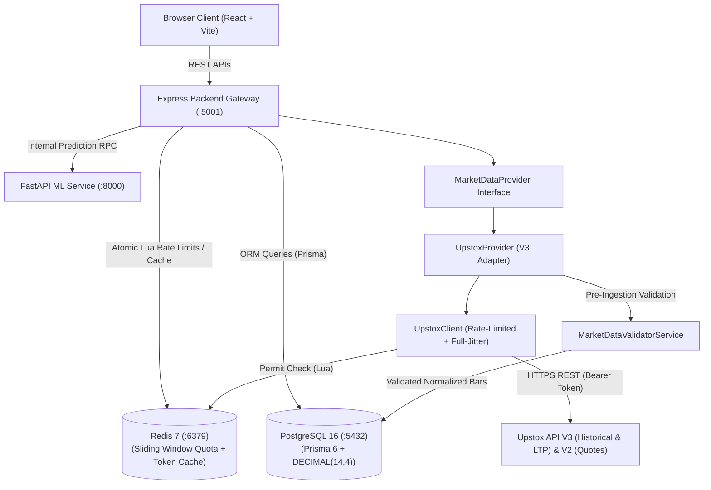

# StockSense AI — System Architecture

## 1. Architectural Principles
- **Decoupled 3-Tier Micro-Service Pattern**:
  1. Frontend Client Layer (React.js SPA)
  2. Gateway & Core Business Logic Layer (Node.js/Express.js)
  3. Analytical & Machine Learning Layer (Python/FastAPI)
- **Single Source of Gateway Truth**:
  The Frontend client is strictly forbidden from querying PostgreSQL, Redis, or FastAPI directly. All traffic is authenticated, validated, rate-limited, and logged by the Express gateway.
- **Provider Abstraction**:
  Market data sources are decoupled behind an abstract class (`MarketDataProvider`), implemented by `UpstoxProvider`. The rest of the application interacts strictly with `MarketDataProvider`, never directly with Upstox or specific HTTP clients.
- **Pre-Ingestion Data Quality Validation**:
  All market data bars pass through `MarketDataValidatorService` before persistence. Enforces strict OHLC logic, positive prices, non-negative volume, timestamp sanity (clock skew buffer), and deduplication. Corrupted bars are rejected without silent tampering.

## 2. Component Diagram



## 3. Data Flow Workflows

### A. Market Overview & Quote Ingestion
1. Client requests `GET /api/market/overview`.
2. Gateway checks Redis for key `market:overview:cache`.
3. If cache hit, return immediately (TTL: 60 seconds).
4. If cache miss, query `MarketDataProvider` (Upstox) for latest quotes and index levels.
5. Ingest quotes, update `HistoricalPrice` / `DataSourceLog` in PostgreSQL.
6. Populate Redis cache and return normalized response to Client.

### B. Prediction & Explainability Pipeline (Future Phase)
1. Gateway receives request for stock recommendation `GET /api/stocks/:id/recommendation`.
2. Gateway gathers historical OHLCV from PostgreSQL and calls FastAPI endpoint `/api/predict`.
3. FastAPI computes technical indicators, feeds features to calibrated XGBoost/Ensemble models, and computes SHAP feature importance values.
4. FastAPI returns prediction `{ action: "BUY", confidence: 0.82, horizon: "3d", shap_summary: [...] }`.
5. Express combines with fundamental health checks and serves validated payload.

## 4. Market Data Precision & Explicit BigInt Serialization
- **DECIMAL(14, 4) Precision Handling**:
  - Prices are strictly validated against PostgreSQL `DECIMAL(14, 4)` constraints.
  - Scale cannot exceed 4 decimal places; excess decimals are rejected with `EXCESS_DECIMAL_PRECISION` (prohibiting silent rounding).
  - Integer digits cannot exceed 10; values exceeding 10 integer digits are rejected with `PRICE_OVERFLOW`.
- **BigInt Volume & Quantity Precision**:
  - Trading volumes and market quantities are handled as native `BigInt` for all Prisma ORM operations and database storage.
  - Large volumes exceeding `Number.MAX_SAFE_INTEGER` ($9,007,199,254,740,991$) never suffer floating-point truncation.
- **Explicit Serialization (Zero Prototype Mutation)**:
  - Standard JavaScript built-in prototypes are strictly unmodified (`BigInt.prototype.toJSON === undefined`).
  - Express API responses serialize `BigInt` values into exact decimal strings via `app.set('json replacer', bigIntJsonReplacer)`.
  - In-memory data structures are recursively normalized at API boundaries via `serializeMarketData()`.
  - Standalone JSON serialization uses `safeJsonStringify()` from `backend/src/utils/json.js`.

## 5. Upstox OAuth 2.0 Security & Architecture
- **Cryptographic State Validation (CSRF Protection)**:
  - Authorization initiation generates a 64-character cryptographically secure random state (32 bytes entropy).
  - Stores only the SHA-256 hash of the state in Redis with a 5-minute (300-second) TTL.
  - Callback consumes state atomically via Redis Lua script (`ATOMIC_CONSUME_STATE_LUA`), preventing replay attacks and race conditions.
- **Single-Use Authorization Code Policy**:
  - The authorization code from Upstox is strictly single-use. The token exchange client strictly disables automatic retries.
  - On network timeout (`ECONNABORTED` after 8,000ms) or provider rejection, the flow halts immediately with an explicit error requiring a fresh OAuth initiation.
- **Token Storage & Encryption**:
  - Access tokens are encrypted with AES-256-GCM using `APP_ENCRYPTION_KEY` and persisted to PostgreSQL `system_configs`.
  - Cached in Redis with TTL strictly bounded by the token's daily 03:30 AM IST expiry.
  - Raw tokens, client secrets, and encryption keys are never logged, returned in API payloads, or exposed to the frontend.
- **HTTP Log & Error Query Redaction**:
  - Morgan, custom loggers, and the central `errorHandler` middleware use `redactString()` to mask `code`, `state`, `client_secret`, and `access_token` query parameters in HTTP access logs, error logs, and client error responses (`meta.path`).
- **Distributed OAuth Rate Limiting & Fail-Closed Safety**:
  - The OAuth initiation endpoint (`/api/auth/upstox/start`) is protected by `DistributedOAuthRateLimiter` using an atomic Redis Lua script (`ATOMIC_OAUTH_RATE_LIMIT_LUA`) enforcing a shared limit of 10 requests per minute per IP across all backend workers.
  - Fail-closed security policy: If Redis is offline or encounters an error, OAuth initiation rejects incoming requests with HTTP 503 (`RATE_LIMITER_OFFLINE`), preventing unthrottled requests across independent processes.
  - Safe client IP extraction (`getSafeClientIp`) normalizes IPv6 loopback addresses (`::1`, `::ffff:127.0.0.1` -> `127.0.0.1`) and prevents arbitrary spoofing via untrusted proxy headers.
- **Strict Anti-Caching & Privacy Headers**:
  - Router-level middleware (`oauthSecurityHeadersMiddleware`) injects `Cache-Control: no-store, no-cache, must-revalidate, private`, `Pragma: no-cache`, `Expires: 0`, and `Referrer-Policy: no-referrer` across all OAuth routes (`/start`, `/callback`, `/status`, `/disconnect`), ensuring authorization codes, states, and session metadata are never cached by intermediate proxies, CDNs, or browser caches.
- **Clean Redirect Destinations**:
  - Successful OAuth callbacks redirect browsers strictly to `${config.corsOrigin}/settings?auth=success` with zero authorization codes or tokens in the destination query string.
  - Provider denials or cancellations redirect cleanly to `${config.corsOrigin}/settings?auth=error&reason=...` with sanitized error descriptions.

## 6. Official Upstox Instrument Master Ingestion Pipeline
- **Source Data**:
  - Consumes the official beginning-of-day (BOD) compressed archive: `https://assets.upstox.com/market-quote/instruments/exchange/complete.json.gz` (~130,000+ instruments across Indian exchanges).
- **Service Modularization**:
  1. `InstrumentDownloader`: Downloads compressed `.json.gz` with full-jitter exponential retry backoff on transient network faults.
  2. `InstrumentParser`: Gunzips compressed stream and validates top-level JSON array structure. Fails safely on corrupt archives (`CORRUPT_ARCHIVE`) or empty files (`EMPTY_DATA`).
  3. `InstrumentValidator`: Normalizes and validates records against Indian market standards:
     - Distinguishes `EQUITY`, `INDEX`, `FUTURES`, `OPTIONS`, `BOND` instrument types.
     - Strictly differentiates `ISIN` (12 alphanumeric code) from `instrumentToken` (Upstox key like `NSE_EQ|INE002A01018`). Never treats them as interchangeable.
     - Preserves native exchange identifiers (`exchangeToken` like BSE scrip `500325`, NSE token `2885`).
     - Three-way classification: accurately separates `validInScope` (equities/indices matching active scope), `validOutOfScope` (derivatives e.g. `NSE_FO`, commodities e.g. `MCX_FO`), and `invalidRecords` (genuinely malformed records). Derivatives are never classified as invalid.
  4. `InstrumentPersistence`: Memory-safe batch upserting into PostgreSQL via Prisma:
     - Batches operations in chunks of 250 items per database transaction.
     - Per-batch transactional isolation: If a batch fails, only that batch rolls back while previously committed batches remain in the database.
     - Uses unique constraint `instrumentToken` to update existing instruments idempotently without creating duplicates.
     - Never deletes or deactivates the existing catalogue if an ingestion run fails.
  5. `InstrumentIngestionService`: Orchestrates the pipeline with distributed concurrency protection (`stocksense:lock:instrument_ingestion` in Redis) using cryptographically unique lock tokens (`crypto.randomUUID()`) and atomic Lua compare-and-delete release script (`if redis.call("get", KEYS[1]) == ARGV[1] then return redis.call("del", KEYS[1]) else return 0 end`) to prevent overlapping runs and older processes from releasing newer locks.
- **Auditing & Tracking**:
  - Ingestion runs are logged in `DataSourceLog` (`operation: 'INSTRUMENT_INGESTION'`) with status (`SUCCESS`, `PARTIAL`, `FAILED`), processed count, error details, and execution time.
  - Latest summary metrics (`totalDownloaded`, `validInScope`, `validOutOfScope`, `invalidRecords`, `insertedRecords`, `updatedRecords`, `skippedRecords`) are stored in `SystemConfig` (`UPSTOX_INSTRUMENT_INGESTION_SUMMARY`).
- **Interfaces & Access Control**:
  - Supported CLI: `npm run ingest:instruments` (with `--all`, `--dry-run`, `--limit=N` options) is the primary supported manual ingestion mechanism.
  - Admin REST API: `POST /api/admin/instruments/ingest` and `GET /api/admin/instruments/status` are explicitly disabled returning HTTP 503 `ADMIN_API_DISABLED` pending full Role-Based Access Control (RBAC) in Milestone 4.

## 7. REST APIs & Redis Caching Layer
- **Consistent Response Envelope**:
  All REST endpoints return a standardized envelope:
  ```json
  {
    "success": true,
    "data": { ... },
    "meta": {
      "cached": false,
      "timestamp": "2026-11-07T14:15:30.000Z",
      "pagination": { "page": 1, "limit": 20, "totalRecords": 19, "totalPages": 1, "hasNextPage": false, "hasPrevPage": false }
    }
  }
  ```
- **Redis Caching Service (`CacheService`)**:
  - **Namespaced Keys**: Standard prefix `stocksense:cache` (e.g. `stocksense:cache:stocks:list:...`, `stocksense:cache:market:overview`).
  - **Deterministic Query String Normalization**: `buildDeterministicQueryString()` sorts query parameter keys alphabetically and trims values, ensuring `/api/stocks?page=1&limit=10` and `/api/stocks?limit=10&page=1` map to the identical cache key, preventing redundant cache entries.
  - **TTL Hierarchy**:
    - `stocks:list`: 300 seconds (5 minutes)
    - `stocks:detail`: 600 seconds (10 minutes)
    - `stocks:search`: 120 seconds (2 minutes)
    - `market:overview`: 30 seconds
    - `market:indices`: 300 seconds (5 minutes)
    - `stocks:prices`: 300 seconds (5 minutes)
  - **Fail-Open Graceful Degradation**:
    If Redis is down, disconnected, or throws a read/write error, `CacheService` catches the exception and returns `null`/`false`. The API transparently queries PostgreSQL as the single source of truth and returns live data with `meta.cached: false`, never crashing user requests.
  - **Non-Blocking Invalidation**:
    Uses Redis `scan` cursor pagination in `invalidatePattern()` to locate and delete matching keys without blocking the single-threaded Redis event loop.
  - **Automated Invalidation on Ingestion**:
    When the instrument master pipeline successfully updates or seeds instruments, `instrumentIngestionService` triggers `cacheService.invalidateStockCatalogueCache()`, clearing all `stocksense:cache:stocks:*` and `stocksense:cache:market:*` keys immediately.
- **REST Endpoints Overview**:
  - `GET /api/stocks`: Paginated catalogue with filtering (`exchange`, `instrumentType`, `segment`, `isActive`), search (`search`/`q`), sorting (`sortBy`, `sortOrder`), and pagination metadata.
  - `GET /api/stocks/search?q=`: Fast typeahead search by symbol or company name (1-50 chars, max limit 25).
  - `GET /api/stocks/:id`: Stock detail resolution by UUID, Upstox instrument token (`|`), or Symbol. Includes exchange metadata.
  - `GET /api/stocks/:id/prices`: Chronological historical OHLCV candlestick records with date filtering (`from`, `to`), intervals (`1m`, `5m`, `15m`, `30m`, `1h`, `1D`, `1W`, `1M`), pagination, and exact BigInt volume string serialization. Returns empty array (not 404) for stocks with no candle history.
  - `GET /api/market/overview`: Real-time platform summary with active instrument count, exchange breakdown (NSE/BSE), instrument type breakdown (EQUITY/INDEX/BOND), Upstox provider status (`tokenService.getTokenStatus()`), and last ingestion metadata. Strictly prohibits fabricated live prices.
  - `GET /api/market/indices`: Verified database-stored index records (e.g. `NIFTY 50`, `SENSEX`). Strictly prohibits synthesized live prices.

## 8. Historical Market Data Ingestion Pipeline (Milestone 3, Step 7)
- **Architecture Overview**:
  - `HistoricalIngestionService`: Orchestrates instrument resolution, date chunking, provider retrieval with rate limits and jitter backoff, validation, persistence, distributed locking, and cache invalidation.
  - `HistoricalPersistence`: Memory-efficient batch upserting into PostgreSQL via Prisma `$transaction`.
- **Date Chunking & Calendar Mechanics**:
  - Chunks requested date ranges according to documented Upstox V3 retrieval limits (daily 1D candles chunked at 365 calendar days).
  - Employs strict UTC calendar arithmetic preventing time drift across leap years (e.g. Feb 29, 2024), month boundaries, quarter boundaries, and year-end rollovers with zero date overlaps and zero gaps.
  - Exchange timestamps are preserved and stored in PostgreSQL `TIMESTAMPTZ` (UTC absolute epoch), correctly interpreting Indian market trading hours (`Asia/Kolkata`, UTC+05:30).
- **Pre-Ingestion Validation**:
  - Enforces strict OHLC logic (`High >= Low, High >= Open, High >= Close, Low <= Open, Low <= Close`).
  - Prohibits silent decimal rounding: scale strictly bounded by PostgreSQL `DECIMAL(14, 4)`.
  - Native `BigInt` volume precision: preserves high-volume institutional quantities without floating-point truncation.
  - Rejects malformed bars and look-ahead timestamps with explicit error codes.
- **PostgreSQL Idempotency & Batching**:
  - Uses compound unique constraint `@@unique([stockId, timestamp, interval])` via Prisma `upsert`.
  - Transaction chunks of 250 records per batch: repeated ingestion runs update existing bars and insert missing bars, producing zero duplicate candles.
  - Never deletes existing valid records on partial API or chunk failure.
- **Distributed Concurrency & Rate Limiting**:
  - Concurrency protected by Redis lock (`stocksense:lock:historical_ingestion`) using cryptographic UUID tokens and atomic Lua compare-and-delete release.
  - Fail-closed safety: if Redis is unavailable, ingestion fails immediately (HTTP 503 `INGESTION_LOCK_UNAVAILABLE`) before querying broker APIs or database.
  - Reuses distributed sliding-window rate limiter (5 req/sec historical quota, full-jitter exponential backoff on HTTP 429).
- **Targeted Cache Invalidation**:
  - Upon successful persistence of new or updated candles, selectively purges only the affected stock's price cache (`stocksense:cache:stocks:prices:${stockId}:*`).
  - Stock detail, catalogue, and market overview caches remain untouched.
- **Audit Logging**:
  - Logs execution details in `DataSourceLog` (`provider: 'UPSTOX', operation: 'SYNC_OHLCV'`, status `SUCCESS | PARTIAL | FAILED`, records processed, execution time, error payload).
  - Persists latest run summary in `SystemConfig` (`UPSTOX_HISTORICAL_INGESTION_SUMMARY`).
- **Developer CLI**:
  - `npm run ingest:historical -- --symbol=RELIANCE --from=2025-01-01 --to=2025-12-31`
  - Supports `--symbol=SYM`, `--symbols=S1,S2`, `--all`, `--dry-run`, and configurable date ranges.

## 9. User Authentication, Session Management & Data Isolation (Milestone 4)
- **Multi-Tenant User & Session Architecture**:
  - `User`: Primary account record with unique email, Argon2id/bcryptjs hashed password, active status flag (`isActive`), and timestamp tracking (`lastLoginAt`).
  - `UserSession`: Database-backed session state storing user reference, creation IP, user-agent, revoked status, idle expiry (`expiresAt`, default 7 days), and absolute session cap (`absoluteExpiresAt`, default 30 days).
  - `UserSessionToken`: Refresh token family ledger storing SHA-256 token hashes, creation timestamps, explicit expiration, and `consumedAt` audit timestamp to enable atomic one-time rotation and instant replay detection.
  - Revocation Cache: Active sessions are verified against Redis (`stocksense:session:revoked:<sessionId>`). If Redis is unavailable, the gateway falls back directly to PostgreSQL `UserSession` and `User` status, enforcing zero security bypass.
- **Argon2id Hashing & Resource Exhaustion Protection**:
  - Default algorithm: Argon2id (`memoryCost: 32768` [32 MiB], `timeCost: 3`, `parallelism: 1`).
  - Strict input validation: Passwords normalized with Unicode NFC, minimum 15 Unicode code points, maximum 128 code points, and 512 UTF-8 bytes (never truncated).
  - Global password hashing concurrency bounded by semaphore (`AUTH_MAX_CONCURRENT_HASHES: 4`) preventing memory exhaustion under burst traffic.
  - Constant-time dummy comparisons executed on failed lookups to prevent user enumeration via timing discrepancies.
- **Atomic One-Time Refresh Token Rotation & Replay Revocation**:
  - Raw refresh tokens are never persisted in the database; only SHA-256 hashes are stored.
  - Refresh rotation is executed within a PostgreSQL serializable transaction using `clock_timestamp()` for exact wall-clock expiration checking.
  - Tokens are atomically consumed via parameterized SQL (`consumedAt = clock_timestamp()` where `tokenHash = $1 AND consumedAt IS NULL AND expiresAt > clock_timestamp()`).
  - Replay Detection: If an incoming refresh token's hash matches an already consumed token (`consumedAt IS NOT NULL`), the entire session family is immediately marked revoked, auth cookies are cleared, and HTTP 401 is returned.
- **Double-Submit CSRF & Origin Defense**:
  - `stocksense_csrf_token`: `HttpOnly; Path=/api; SameSite=Lax` cookie storing `<rawToken>.<hmacSignature>`.
  - Frontend client fetches raw token via `GET /api/auth/csrf` and transmits it in header `X-CSRF-Token` for state-changing requests (POST, PUT, PATCH, DELETE).
  - Gateway validates HMAC-SHA256 signature in constant time and verifies exact origin/referer against whitelisted origins (`getWhitelistedOrigins()`).
  - Pure non-cookie Bearer requests bypass CSRF; requests with auth cookies must always pass CSRF even if Bearer headers are present.
- **Cookie Path Consistency & Host-Only Cookie Policy**:
  - `stocksense_access_token`: `Path=/api; HttpOnly; SameSite=Lax; Max-Age=15m`. Scoped strictly to authenticated API endpoints (`/api/*`). Avoids leaking credentials to root static asset requests (`/`, `*.js`, `*.css`).
  - `stocksense_refresh_token`: `Path=/api/auth; HttpOnly; SameSite=Lax; Max-Age=7d`. Scoped strictly to token refresh and logout routes (`/api/auth/*`). Never transmitted on ordinary data calls (`/api/stocks`, `/api/watchlists`, `/api/alerts`).
  - `stocksense_csrf_token`: `Path=/api; HttpOnly; SameSite=Lax; Max-Age=7d`. Scoped to mutation endpoints.
  - Cookie clearance (`res.clearCookie`) strictly specifies matching `path` (`/api` vs `/api/auth`), `domain`, `sameSite`, and `secure` attributes.
  - **Host-Only vs Domain Cookie Trade-offs**:
    - By omitting `Domain` (`COOKIE_DOMAIN` unset / undefined), modern browsers enforce **Host-Only Cookies** (RFC 6265).
    - Advantage: Complete protection against sibling subdomain compromise (`blog.stocksense.ai`, `staging.stocksense.ai`). Host-only cookies set by `api.stocksense.ai` are sent on credentialed fetch calls from `https://stocksense.ai` to `https://api.stocksense.ai` without requiring wildcard apex scoping.
    - Explicit `Domain=.stocksense.ai` is only needed if client JavaScript on `stocksense.ai` needed direct cookie access (prohibited for HttpOnly) or across multiple API clusters (`api1.stocksense.ai`, `api2.stocksense.ai`). Defaulting to host-only minimizes attack surface.
- **Cross-Origin / Same-Site Cookie Deployment Topology**:
  - **Topology 1 (Unified Domain / Reverse Proxy)**: Frontend and API hosted on `stocksense.ai` and `stocksense.ai/api`. Host-only `SameSite=Lax; Secure=true; HttpOnly`.
  - **Topology 2 (Same-Site Cross-Origin Subdomains)**: Frontend on `https://stocksense.ai` and API on `https://api.stocksense.ai`. Because they share the eTLD+1 (`stocksense.ai`), browsers treat them as same-site. Host-only cookies set by `api.stocksense.ai` with `SameSite=Lax; Secure=true` are sent on credentialed fetch requests (`credentials: 'include'`).
  - **Topology 3 (Fully Cross-Site / Third-Party Platforms)**: Frontend on `stocksense.vercel.app` and API on `stocksense-api.railway.app`. Requires `SameSite=None; Secure=true` (`COOKIE_SAMESITE=none`), dynamically handled by `getCookieOptions()`.
- **Frontend Single-Flight Refresh Mutex**:
  - `frontend/src/services/api.js` maintains an in-memory refresh promise mutex (`refreshPromise`).
  - Multiple concurrent 401 responses wait on the same in-flight `POST /api/auth/refresh` request, ensuring only one rotation operation hits the backend and eliminating race-conditioned replay detection triggers.
- **Persistent Watchlists & Guest Synchronization**:
  - `Watchlist` & `WatchlistStock`: Relational tables linking users to saved stocks with sort orders and notes.
  - Partial Unique Index (`unique_user_default_watchlist` on `(userId) WHERE isDefault = true`) guarantees exactly one default watchlist per user in PostgreSQL.
  - Default watchlists are protected against deletion and cannot be renamed into an inconsistent state.
  - Guest Sync: `POST /api/watchlists/sync` idempotently ingests client `localStorage` items upon initial login/registration, reporting added, skipped, and invalid items while preserving existing server items. LocalStorage is retained until successful server confirmation.
- **Stock Alert Rules Subsystem**:
  - `StockAlert`: Relational persistence of user price alerts (`PRICE_ABOVE`, `PRICE_BELOW`, `PCT_CHANGE_UP`, `PCT_CHANGE_DOWN`) with active/paused status and target thresholds.
  - Complete multi-user isolation: User B cannot view, modify, or delete User A's alerts or watchlists.
  - Automated background price evaluation and notification dispatch is cleanly decoupled and scheduled for Milestone 5.

## 10. Historical Market Data Foundation & Trading Calendar Engine (Milestone 5, Phase 5A)
- **Indian Equity Trading Calendar Engine (`backend/src/utils/tradingCalendar.js`)**:
  - Exchange Holiday Schedules: Comprehensive dictionary of official Indian stock exchange holidays (NSE/BSE) across 2021 through 2026. Includes Republic Day, Independence Day, Gandhi Jayanti, Diwali Laxmi Pujan, Diwali Balipratipada, Holi, Eid, Good Friday, Gurunanak Jayanti, and special election/civic closures.
  - Asia/Kolkata Timezone (UTC+05:30): Weekend detection checks calendar dates in IST so that UTC boundary rollovers do not skew weekday classification.
  - `isTradingDay(dateOrStr)`: Returns true if and only if the date is not a weekend (Saturday or Sunday) and not an official exchange holiday.
  - `getExpectedTradingDays(fromDate, toDate)`: Generates strict chronological arrays of expected trading days.
  - `analyzeCandleGaps(expectedTradingDays, candleTimestamps)`: Computes actual candle coverage vs expected trading days. Accurately isolates missing trading days, multi-day unexpected gaps ($\ge 2$ consecutive days), and coverage percentage without falsely reporting weekends or holidays as missing data.
- **Provider Date Chunking & Range Management (Upstox V3)**:
  - For daily interval (`1D`), Upstox V3 accepts requests with spans of up to 365 calendar days (`maxSpanDays = 365`).
  - Target 3–5 year historical spans are partitioned into consecutive, non-overlapping 365-day chunks with zero day loss across leap year boundaries (e.g. 2024 leap year 29-day February).
  - Individual chunk failures are tracked in `failedChunks` and do not cause premature aborts or discard valid data retrieved from other chunks.
- **Redis Distributed Locking & Fail-Closed Safety**:
  - Lock Key: `stocksense:lock:historical_ingestion` with default TTL of 900 seconds (15 minutes).
  - Cryptographic Ownership: Acquires lock using atomic `SET NX EX` with a unique UUID token.
  - Background Heartbeat: Periodically renews lock TTL via atomic Lua script (`_renewLock`) every 1/3 of the TTL window while actively ingesting.
  - Fail-Closed Safety: Redis is mandatory for historical ingestion. If Redis is unavailable or lock ownership check fails (`_assertLockHeld`), ingestion immediately aborts with `INGESTION_LOCK_LOST` (500/503), preventing overlapping concurrent runs.
  - Atomic Release: Released via atomic Lua compare-and-delete script (`_releaseLock`), ensuring a slower worker never inadvertently deletes a lock acquired by a newer process.
- **Incremental Ingestion Strategy**:
  - In incremental mode (`--incremental` or `incremental: true`), the service checks PostgreSQL for the latest stored candle for each target stock.
  - If the database already holds data up to the requested `toDate`, the stock is marked `alreadyUpToDate: true` and external provider calls are skipped entirely.
  - If stored data is stale, `fromDate` is adjusted to the latest stored candle date, refreshing the boundary bar and retrieving only subsequent missing trading days.
- **Batch Persistence & Idempotency**:
  - `HistoricalPersistence.persistBatch`: Batches validated candles (default 250 records per batch) using Prisma `$transaction`.
  - Compound Unique Constraint: Relies on `@@unique([stockId, timestamp, interval])` on table `historical_prices`.
  - Within-batch duplicate timestamps are deduplicated prior to database execution (`skipped: 1, inserted: 1`), while subsequent batches update existing records in place (`updated: 1, inserted: 0`).
  - Preserves native `BigInt` volume and `DECIMAL(14, 4)` price formatting.
  - Cache Invalidation: Calls `cacheService.invalidateStockPricesCache(stock.id)` upon successful persistence.

## 11. Technical Analysis & ML Feature Engineering Pipeline (Milestone 5, Phase 5B)
- **Decoupled Python/FastAPI Microservice Architecture**:
  - The analytical and feature-engineering engine is maintained strictly in `ml-service/` using Python, NumPy, and Pandas.
  - The Express API gateway acts as the frontend client's single point of entry (`GET /api/stocks/:id/indicators`, `GET /api/stocks/:id/features`).
  - Express communicates with FastAPI via `MLServiceClient` (`backend/src/services/mlClient.service.js`) with fail-closed timeout and connection error classification (`ML_SERVICE_UNAVAILABLE`).
- **Mathematical Formulations & Warm-up Specifications**:
  1. **Simple Moving Average (SMA)**:
     - Periods: 20, 50, 200.
     - Formula: $\text{SMA}_n(t) = \frac{1}{n} \sum_{i=0}^{n-1} P_{t-i}$.
     - Warm-up: First $n - 1$ entries are `NaN`. First valid value at index $n - 1$.
  2. **Exponential Moving Average (EMA)**:
     - Periods: 12, 26, 50.
     - Formula: $\alpha = \frac{2}{n + 1}$, $\text{EMA}_n(t) = P_t \cdot \alpha + \text{EMA}_n(t-1) \cdot (1 - \alpha)$.
     - Seeding: First valid EMA at index $n - 1$ is initialized with the SMA of the first $n$ prices.
     - Warm-up: First $n - 1$ entries are `NaN`.
  3. **Relative Strength Index (RSI)**:
     - Period: 14.
     - Formula: Uses Wilder's Smoothed Moving Average (RMA):
       $\text{AvgGain}_t = \frac{\text{AvgGain}_{t-1} \times 13 + \text{Gain}_t}{14}$, $\text{AvgLoss}_t = \frac{\text{AvgLoss}_{t-1} \times 13 + \text{Loss}_t}{14}$.
       $\text{RSI}_t = 100 - \frac{100}{1 + \text{RS}_t}$.
     - Edge Cases: If $\text{AvgLoss} = 0$, $\text{RSI} = 100.0$; if both zero, $\text{RSI} = 50.0$.
     - Warm-up: First 14 entries are `NaN`. First valid RSI appears at index 14.
  4. **Moving Average Convergence Divergence (MACD)**:
     - Parameters: Fast = 12, Slow = 26, Signal = 9.
     - Formula: $\text{MACD Line} = \text{EMA}_{12} - \text{EMA}_{26}$, $\text{Signal Line} = \text{EMA}_9(\text{MACD Line})$, $\text{Histogram} = \text{MACD Line} - \text{Signal Line}$.
     - Warm-up: First valid Histogram at index 33 ($26 + 9 - 2$).
  5. **Bollinger Bands**:
     - Period: 20, Multiplier: $2\sigma$.
     - Formula: $\text{Middle} = \text{SMA}_{20}(P)$, $\text{Upper} = \text{Middle} + 2\sigma$, $\text{Lower} = \text{Middle} - 2\sigma$.
     - Derived: $\%B = \frac{P - \text{Lower}}{\text{Upper} - \text{Lower}}$ (safe 0.5 on flat prices), $\text{Bandwidth} = \frac{\text{Upper} - \text{Lower}}{\text{Middle}}$.
     - Warm-up: First 19 entries are `NaN`.
  6. **Average True Range (ATR)**:
     - Period: 14.
     - Formula: $\text{TR}_t = \max(H_t - L_t, |H_t - C_{t-1}|, |L_t - C_{t-1}|)$, smoothed via Wilder's RMA.
     - Warm-up: First 13 entries are `NaN`.
  7. **Daily Percentage Returns**:
     - Formula: $R_t = \frac{C_t - C_{t-1}}{C_{t-1}} \times 100$. Index 0 is `NaN`.
  8. **Rolling Volatility**:
     - Formula: $\sigma_{\text{daily}, 20}(t) \times \sqrt{252}$ (annualized 20-day standard deviation of returns).
     - Warm-up: First 20 return observations are `NaN`.
  9. **Volume Moving Average & Relative Volume (RVOL)**:
     - Formula: $\text{VolSMA}_{20}(t) = \frac{1}{20}\sum V_{t-i}$, $\text{RVOL}_t = \frac{V_t}{\text{VolSMA}_{20}(t)}$.
     - Safe Division: When VolSMA is 0, RVOL is 0.0 without divide-by-zero errors.
- **Causality & Zero Look-Ahead Bias Guarantee**:
  - All rolling calculations strictly look backward in time ($[t-N+1 \dots t]$). Modifying any future bar $t+k$ strictly causes zero alteration to values at $t$.
- **Engineered ML Features**:
  - `price_to_sma20`, `price_to_sma50`, `price_to_sma200`: percentage distance from major moving averages.
  - `price_to_ema12`, `price_to_ema26`, `price_to_ema50`: short- and intermediate-term trend distance.
  - `rsi_normalized`: centered at 0 in range $[-1.0, 1.0]$.
  - `rsi_slope_5`: 5-day rate of change of RSI momentum.
  - `macd_hist_normalized`: MACD histogram normalized by current close.
  - `bb_percent_b`, `bb_zscore`, `bb_bandwidth`: non-linear volatility band position.
  - `atr_pct`: price-normalized volatility scale.
  - `return_1d`, `return_5d`, `return_21d`: multi-horizon momentum.
  - `volatility_20d`, `relative_volume_20`: volume and volatility regimes.
  - `trend_alignment`: Moving average stack hierarchy ($+1.0$ for bullish $\text{SMA}_{20} > \text{SMA}_{50} > \text{SMA}_{200}$, $-1.0$ for bearish).
  - `ma_spread_50_200`, `ma_spread_20_50`: golden/death cross spreads.
- **Real Market Data Consumption Workflow**:
  1. Once Upstox API credentials are approved, historical candles are ingested into PostgreSQL `historical_prices` via `npm run ingest:historical -- --all`.
  2. When `/api/stocks/:id/indicators` or `/api/stocks/:id/features` is called, the Express gateway loads stored candles from PostgreSQL, forwards them to FastAPI, and caches computed payloads in Redis with a 300s TTL.
