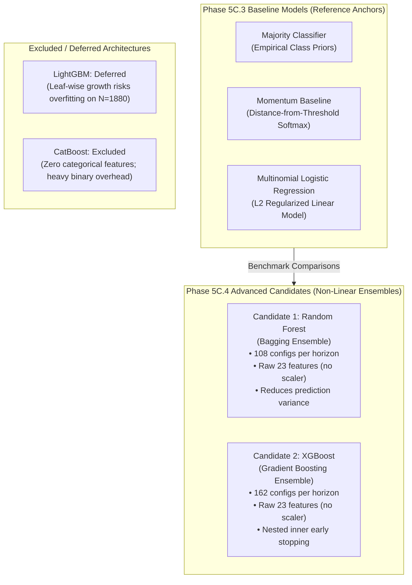
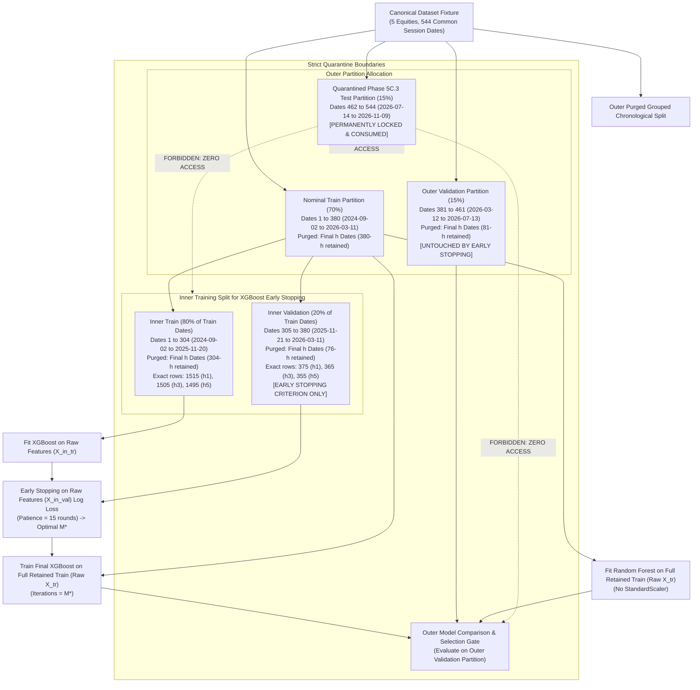

# StockSense AI — Phase 5C.4.1: Advanced ML Model Research & Design

**Document Reference:** `docs/phase-5c4-1-advanced-ml-model-research-and-design.md`<br>
**Phase:** Phase 5C.4.1 — Advanced ML Model Research & Design (Revision 3.1)<br>
**Branch:** `feature/phase-5c-ml-training`<br>
**Git HEAD:** `643d6919dd5409e5755955282617bef8607a63ad`<br>
**Date:** November 16, 2026<br>
**Status:** **PROPOSED & SUBMITTED FOR ARCHITECTURAL REVIEW**

---

## 1. Executive Summary

Phase 5C.3 established the baseline machine learning foundation of StockSense AI, implementing the **Majority Classifier**, **Momentum Baseline**, and a validation-tuned **Multinomial Logistic Regression (L2)** classifier across three prediction horizons ($h \in \{1, 3, 5\}$ trading sessions). The controlled test evaluation conducted on the held-out test partition revealed that linear models exhibit limited predictive power:
- At $h=1$, Logistic Regression demonstrated a modest edge over baselines (balanced accuracy of $0.3652$ vs. $0.3333$ for Majority and $0.3328$ for Momentum; $+3.19$ and $+3.24$ percentage points).
- At $h=3$, performance deteriorated to near-random levels (balanced accuracy of $0.3345$), with high catastrophic directional error rates ($50.19\%$ in the directional subset).
- At $h=5$, performance dropped below random chance (balanced accuracy of $0.3015$), underperforming both the Majority baseline ($-3.18$ percentage points) and the Momentum baseline ($-3.92$ percentage points).

These empirical findings confirm that financial asset returns over short-to-medium horizons are governed by complex, nonlinear market microstructure dynamics and state-dependent feature interactions that cannot be captured by linear hyperplanes.

**Phase 5C.4.1** researches, benchmarks, and designs an advanced machine learning experimentation framework. This document investigates four non-linear tree-based ensemble architectures:
1. **Random Forest (`RandomForestClassifier`)**: Bagging ensemble reducing variance through feature subsampling and tree aggregation.
2. **XGBoost (`XGBClassifier`)**: Second-order gradient boosted decision trees with structural tree regularization ($L_1, L_2, \gamma$) and column subsampling.
3. **LightGBM (`LGBMClassifier`)**: Fast histogram-based leaf-wise gradient boosting with optional GOSS subsampling.
4. **CatBoost (`CatBoostClassifier`)**: Gradient boosting with symmetric oblivious decision trees and ordered target statistics.

### Core Recommendations & Methodological Governance
- **Primary Advanced Architecture:** Prioritize a disciplined dual-model strategy:
  1. **Random Forest** as the canonical non-linear bagging baseline (reduces prediction variance, natively available in `scikit-learn`).
  2. **XGBoost** as the primary regularized gradient boosting candidate (second-order loss optimization, explicit tree pruning and leaf regularization, declared in `requirements.txt`).
- **Scope Restriction on LightGBM and CatBoost:**
  - **LightGBM** is deferred: its unconstrained leaf-wise growth poses small-sample overfitting risks on our training partition ($N \approx 1,880$), while its histogram binning speed advantage is negligible on $P=23$ features.
  - **CatBoost** is explicitly excluded from active scope: its defining feature—ordered target encoding of high-cardinality categorical variables—is completely unutilized because StockSense AI's 23 features are strictly continuous numerical floats.
- **Direct Raw Feature Processing (Zero Scaler Overhead for Tree Ensembles):** Because decision tree split criteria are strictly invariant under monotonic transformations, Random Forest and XGBoost will ingest the exact 23 approved numerical features directly without fitting or applying `StandardScaler`. The existing Logistic Regression baseline's train-only `StandardScaler` methodology remains completely intact and unchanged.
- **Strict Inner/Outer Validation Separation for Early Stopping:** To prevent leakage and double-use of validation data, early stopping for XGBoost is performed on a **nested chronological inner validation split** within the training partition. The outer validation partition remains completely untouched by early-stopping decisions and is reserved solely for model comparison and hyperparameter selection.
- **Permanent Quarantine of Phase 5C.3 Test Partition:** The Phase 5C.3 test partition ($N_{\text{te}} \in \{410, 400, 390\}$) is permanently consumed under experiment `eval_phase_5c3_final_test_20261116`. It must **never** be reused for model selection, hyperparameter tuning, feature selection, or post-hoc generalization claims under a new experiment ID. Any future out-of-sample benchmark requires a **genuinely fresh forward market dataset** ($T > \text{Nov 9, 2026}$).
- **Explicit Experiment Budget:** Total search space is capped at exactly **810 configurations across three horizons** (Random Forest: 108 configs/horizon; XGBoost: 162 configs/horizon), governed by deterministic random seeds, failed-run handling, and clear tie-breaking rules.

---

## 2. Current ML Baseline Assessment

### 2.1 Empirical Baseline Summary (Phase 5C.3)

All models were evaluated on the identical purged grouped test partition ($N=410, 400, 390$ for $h=1, 3, 5$) comprising five large-cap Indian equities (`RELIANCE`, `TCS`, `INFY`, `HDFCBANK`, `ICICIBANK`):

| Horizon | Model | Balanced Accuracy | Macro F1 | Log Loss | Brier Score | Directional Catastrophic Error Rate |
| :---: | :--- | :---: | :---: | :---: | :---: | :---: |
| **$h=1$** | **Logistic Regression** ($C=0.001$, `None`) | **0.3652** | **0.3064** | **1.0966** | **0.6641** | **22.85%** (61/267) |
| | Majority Baseline | 0.3333 | 0.1724 | 1.1015 | 0.6672 | 0.00% (0/267) |
| | Momentum Baseline | 0.3328 | 0.2954 | 1.1102 | 0.6729 | 24.34% (65/267) |
| **$h=3$** | **Logistic Regression** ($C=0.001$, `balanced`) | **0.3345** | **0.3282** | **1.1046** | **0.6713** | **50.19%** (131/261) |
| | Majority Baseline | 0.3333 | 0.1719 | 1.1070 | 0.6709 | 0.00% (0/261) |
| | Momentum Baseline | 0.3487 | 0.3125 | 1.1017 | 0.6687 | 45.98% (120/261) |
| **$h=5$** | **Logistic Regression** ($C=0.01$, `balanced`) | **0.3015** | **0.2890** | **1.1318** | **0.6879** | **50.21%** (119/237) |
| | Majority Baseline | 0.3333 | 0.1878 | 1.0986 | 0.6662 | 0.00% (0/237) |
| | Momentum Baseline | 0.3408 | 0.3132 | 1.0992 | 0.6669 | 45.15% (107/237) |

### 2.2 Diagnosis of Linear Model Failure Modes

1. **Linear Hyperplane Inadequacy:**
   Multinomial Logistic Regression models class logits as linear combinations of features:
   $$\eta_k(x) = w_k^T x + b_k, \quad P(y=k \mid x) = \frac{\exp(\eta_k(x))}{\sum_{j} \exp(\eta_j(x))}$$
   In equity markets, indicators interact conditionally. For example, high RSI ($>70$) signals momentum breakout in a strong trend regime (`trend_alignment = 1`, `bb_bandwidth` expanding), but signals mean-reversion exhaustion in a range-bound regime (`trend_alignment = 0`, `bb_bandwidth` contracting). A single global weight vector $w_k$ cannot capture these contradictory regime states.

2. **Severe Class Collapse at Short Horizons ($h=1$):**
   At $h=1$, the optimal L2 regularizer selected was extremely strong ($C=0.001$). Under unweighted class priors, the model collapsed predictions into `NEUTRAL` and `DOWN`, predicting `UP` for only 9 out of 410 test instances (recall for `UP` was an abysmal $0.81\%$).

3. **Catastrophic Directional Inversion at Longer Horizons ($h=3, 5$):**
   When class weighting was applied to counteract class collapse ($h=3, 5$), the linear model swung aggressively, yielding directional catastrophic error rates of $50.19\%$ and $50.21\%$. Half of all instances where the actual move was directional ($+1$ or $-1$) were predicted in the exact opposite direction.

4. **Horizon-Dependent Generalization Degradation:**
   As the horizon expands from $h=1$ to $h=5$, test balanced accuracy drops monotonically from $0.3652 \to 0.3345 \to 0.3015$, while test log loss increases from $1.0966 \to 1.1046 \to 1.1318$. This reflects signal decay and increasing label noise.

---

## 3. Candidate Model Comparison

We evaluate four non-linear ensemble architectures against the rigorous requirements of financial time-series classification.

### 3.1 Random Forest (`RandomForestClassifier`)

#### How the Algorithm Works
Random Forest (Breiman, 2001) is an ensemble of $B$ decorrelated decision trees constructed via Bootstrap Aggregating (Bagging). Each tree $b \in \{1, \dots, B\}$ is fitted on a random sample of the training data drawn with replacement (or subsampled without replacement). At each node split, the search for the optimal split threshold is restricted to a randomly selected subset of $m$ features ($m \approx \sqrt{P} \approx \sqrt{23} \approx 4$ or $5$). Final class probabilities are obtained via soft voting across all trees:
$$\hat{P}(y = k \mid x) = \frac{1}{B} \sum_{b=1}^B P_b(y = k \mid x)$$

#### Nonlinearity & Feature Interactions
Random Forest inherently segments the 23-dimensional feature space into axis-aligned hyper-rectangles. A tree of depth $D$ can model up to $D$-way feature interactions without requiring explicit polynomial feature expansion or kernel transformations.

#### Variance Reduction vs. Generalization Realities
- **Variance Stabilization:** Increasing the number of trees $B$ reduces the variance of the ensemble prediction via the Law of Large Numbers, stabilizing probability estimates.
- **Overfitting Reality:** **Increasing the number of trees does NOT guarantee generalization and does NOT eliminate overfitting.** If individual trees are allowed to grow too deep (`max_depth=None`, `min_samples_leaf=1`), they will split on microscopic noise spikes in the training set. A forest of 1,000 deep trees will simply produce a low-variance average of an overfitted, biased predictor.
- **Breiman's Bound Interpretation:** Breiman proved that as $B \to \infty$, the generalization error of a random forest is bounded by:
  $$PE^* \le \frac{\bar{\rho}(1 - s^2)}{s^2}$$
  where $s$ is the average strength of the individual trees and $\bar{\rho}$ is their average pairwise correlation. In financial markets where technical indicators have low signal-to-noise ratios ($s \ll 1$) and cross-asset correlation is high ($\bar{\rho}$ elevated), this theoretical bound is loose. Adding trees cannot compensate for inadequate pruning, noisy features, or temporal distribution shifts.
- **Zero Preprocessing Requirement:** Decision trees split solely on rank-order inequalities ($x_j \le \tau$). They are mathematically invariant to monotonic feature scaling. Random Forest will ingest the raw 23 features directly without `StandardScaler`.
- **Zero Additional Dependency Footprint:** Natively implemented in `scikit-learn` 1.9.1, already installed and tested in the project virtual environment.
- **Candidate Status:** The proposed constrained search space (`max_depth` $\le 6$, `min_samples_leaf` $\ge 15$) is a **candidate design** to limit tree depth and enforce statistical support, not a proven optimal configuration.

---

### 3.2 XGBoost (`XGBClassifier`)

#### How the Algorithm Works
XGBoost (Chen & Guestrin, 2016) is a scalable, regularized gradient boosted decision tree (GBDT) framework. Unlike bagging, boosting constructs trees sequentially. At step $m$, tree $f_m(x)$ is fitted to the negative gradient of the loss function evaluated at step $m-1$. For multi-class classification ($K=3$), XGBoost minimizes the multi-class cross-entropy loss (`multi:softprob`) using a second-order Taylor expansion of the objective:
$$\tilde{\mathcal{L}}^{(m)} \approx \sum_{i=1}^N \sum_{k=1}^K \left[ g_{ik} f_{mk}(x_i) + \frac{1}{2} h_{ik} f_{mk}^2(x_i) \right] + \Omega(f_m)$$
where $g_{ik} = \frac{\partial \mathcal{L}}{\partial \hat{y}_{ik}}$ (gradient), $h_{ik} = \frac{\partial^2 \mathcal{L}}{\partial \hat{y}_{ik}^2}$ (Hessian), and the tree complexity regularizer is:
$$\Omega(f) = \gamma T + \frac{1}{2} \lambda \sum_{j=1}^T w_j^2 + \alpha \sum_{j=1}^T |w_j|$$
with $T$ being the number of terminal leaves, $\gamma$ the minimum loss reduction required for a split, and $\lambda, \alpha$ being $L_2$ and $L_1$ leaf weight penalties.

#### Nonlinearity & Feature Interactions
Each boosted tree corrects the residual errors of the previous ensemble. A depth-$D$ tree captures up to $D$-th order feature interactions. The shrinkage parameter $\eta \in (0, 1]$ (learning rate) scales each tree's contribution:
$$\hat{y}_i^{(m)} = \hat{y}_i^{(m-1)} + \eta f_m(x_i)$$
preventing any single tree from dominating the model.

#### Advantages for StockSense AI
- **Rigorous Mathematical Regularization:** Explicitly penalizes both leaf count ($T$ via $\gamma$) and leaf weight magnitudes ($\lambda, \alpha$). This prevents extreme log-odds predictions on small financial samples.
- **Column and Row Subsampling:** Supports stochastic feature subsampling (`colsample_bytree`) and row subsampling (`subsample < 1.0`), injecting bagging-like variance reduction into gradient descent.
- **Hessian-Dependent Minimum Child Weight:** `min_child_weight` enforces a minimum sum of instance Hessians in a leaf. For multi-class log loss (`multi:softprob`), second-order Hessians are bounded by $h_{ik} = p_{ik}(1 - p_{ik}) \le 0.25$. Therefore, a `min_child_weight` of 15 implies that a leaf must contain an aggregate effective instance weight equivalent to at least $\approx 60$ observations ($15 / 0.25 = 60$). The candidate value $15.0$ must be treated as a candidate parameter requiring empirical validation rather than a universal constant.
- **Direct Raw Feature Ingestion:** Like Random Forest, XGBoost tree building relies solely on threshold inequalities. It will ingest the raw 23 features directly without `StandardScaler`.
- **Project Compatibility:** Declared in `requirements.txt` (`xgboost>=2.1.0`).

#### Disadvantages & Overfitting Risks on Small Data
- **High Sensitivity to Hyperparameters:** On $N \approx 1,880$, an unregularized XGBoost model will overfit to near-zero training error within 15 iterations.
- **Early Stopping Requirement:** Strictly requires early stopping to halt boosting before noise fitting begins. To eliminate leakage, early stopping must be guided by an inner validation split within the training partition, completely segregated from outer model selection.
- **Probability Overconfidence:** Gradient boosting tends to output uncalibrated, overconfident probabilities near 0 and 1, which can severely distort log loss and Brier score.

---

### 3.3 LightGBM (`LGBMClassifier`)

#### How the Algorithm Works
LightGBM (Ke et al., 2017) is an optimized GBDT framework designed for large-scale datasets. It introduces two separate architectural features:
1. **Histogram-based Split Finding:** Bins continuous feature values into discrete integer bins (typically 256), reducing split evaluation complexity from $\mathcal{O}(N \times P)$ to $\mathcal{O}(\text{bins} \times P)$.
2. **Leaf-Wise (Best-First) Tree Growth:** Unlike level-wise (depth-first) growth used by traditional GBDTs, LightGBM chooses the leaf that produces the greatest loss reduction, irrespective of tree balance.
3. **Gradient-based One-Side Sampling (GOSS):** An *available alternative boosting option* (`boosting_type="goss"`). GOSS retains instances with large gradients while randomly subsampling instances with small gradients. Under default configuration (`boosting_type="gbdt"`), standard random or full subsampling is used.

#### Suitability & Evaluation for StockSense AI
- **Irrelevance of Speed Advantages:** LightGBM was engineered for datasets with millions of rows and thousands of sparse features. In StockSense AI, our training partition contains $N \approx 1,880$ rows and $P = 23$ dense features. Training XGBoost or Random Forest on this dataset takes less than 300 milliseconds. LightGBM's histogram binning yields zero practical speed benefit.
- **Severe Small-Sample Overfitting Danger:** Leaf-wise growth is structurally prone to constructing deep, asymmetric, single-branch paths that overfit idiosyncratic outliers when $N$ is small. Although `max_depth` can constrain tree height, the underlying best-first split mechanic fundamentally biases the model toward aggressive outlier exploitation.
- **External Dependencies:** Requires OpenMP (`libomp`) on macOS, which frequently introduces system-level runtime dynamic link errors in development environments.
- **Recommendation:** **Deferred.** There is no compelling technical reason to introduce LightGBM given the small sample size and availability of regularized XGBoost.

---

### 3.4 CatBoost (`CatBoostClassifier`)

#### How the Algorithm Works
CatBoost (Prokhorenkova et al., 2018) is a gradient boosting framework built on **Oblivious (Symmetric) Decision Trees**. In an oblivious tree, the identical splitting feature and threshold are applied across all nodes at the same tree depth. The tree operates as a symmetric lookup table of depth $D$ containing exactly $2^D$ leaves. CatBoost also implements **Ordered Boosting**, computing target statistics and gradient steps using independent virtual historical subsets to eliminate target leakage during categorical feature encoding.

#### Suitability & Evaluation for StockSense AI
- **Redundant Core Capability:** CatBoost's primary architectural advantage is its automated, leakage-safe target encoding of high-cardinality categorical features. In StockSense AI, **all 23 features in the approved feature allowlist are continuous floating-point values**. There is zero categorical data in the feature matrix $X$.
- **Symmetric Tree Limitations:** While oblivious trees provide strong regularization, their symmetric structure forces every branch of depth $d$ to split on the exact same feature. In financial technical analysis, feature relevance is highly asymmetric (e.g., if `bb_bandwidth` is narrow, `price_to_sma20` is informative; if wide, `rsi_slope_5` is informative).
- **Excessive Dependency Overhead:** Adding CatBoost requires introducing a multi-hundred-megabyte C++ binary dependency into the microservice. Given that its defining advantage (categorical encoding) is completely unutilized, there is **no technical justification** for expanding the microservice dependency footprint to include CatBoost.
- **Recommendation:** **Explicitly excluded from scope.**

---

### 3.5 Comprehensive Dimension-by-Dimension Comparison

| Evaluation Dimension | Multinomial Logistic Regression (Phase 5C.3 Baseline) | Random Forest (`RandomForestClassifier`) | XGBoost (`XGBClassifier`) | LightGBM (`LGBMClassifier`) | CatBoost (`CatBoostClassifier`) |
| :--- | :---: | :---: | :---: | :---: | :---: |
| **Ensemble Paradigm** | None (Single Linear Model) | Bagging (Bootstrap Aggregation) | Boosting (Second-order GBDT) | Boosting (Histogram Leaf-wise GBDT) | Boosting (Oblivious Symmetric GBDT) |
| **Split Architecture** | Global Hyperplane | Level-wise, orthogonal axis-aligned | Level-wise (exact/hist), depth-first | Leaf-wise (best-first) | Symmetric (oblivious table) |
| **Feature Preprocessing** | Train-only `StandardScaler` | **Raw 23 features (no scaler)** | **Raw 23 features (no scaler)** | Raw 23 features (no scaler) | Raw 23 features (no scaler) |
| **Feature Interactions** | None (purely additive: $\sum w_i x_i$) | Native, orthogonal $D$-way | Native, regularized $D$-way | Native, unconstrained leaf paths | Constrained symmetric interactions |
| **Small-Sample Behavior ($N \approx 1,880$)** | Low variance, high bias (underfitting) | Robust variance reduction if pruned | Robust if strictly regularized ($\lambda, \gamma$) | High overfitting risk (leaf-wise) | Moderately robust, but inflexible |
| **Hyperparameter Sensitivity** | Very low ($C$, class weight) | Low (`n_estimators`, `max_depth`, `min_samples_leaf`) | High ($\eta$, `max_depth`, `subsample`, `colsample`, $\lambda$) | Very high (`num_leaves`, `min_child_samples`) | Moderate (`iterations`, `depth`, `l2_leaf_reg`) |
| **Probability Calibration** | Well-calibrated log-odds | Moderately conservative, soft-voted | Often overconfident at margins | Often overconfident | Tendency toward overconfidence |
| **C++ / System Dependencies** | Pure Python / BLAS | Pure Python / BLAS (in scikit-learn) | C++ core (pip precompiled wheels) | C++ / OpenMP (`libomp` on macOS) | C++ heavy bundle ($>150$ MB) |
| **Existing Environment Status** | Installed & operational | Installed & operational | Declared in `requirements.txt` | Not installed | Not installed |
| **Value Add Over Baselines** | Baseline Anchor | High: non-linear variance reduction | High: targeted gradient loss minimization | Moderate: redundant with XGBoost | Low: categorical features unused |
| **Recommended Scope** | **Baseline Reference** | **Primary Candidate (Phase 5C.4)** | **Primary Candidate (Phase 5C.4)** | **Deferred / Secondary** | **Excluded from Scope** |

---

## 4. Dataset Suitability Analysis

Stock market financial time-series data presents unique structural challenges that violate textbook machine learning assumptions (IID observations, high signal-to-noise ratio, stationarity). Any advanced model design must directly account for these empirical properties:

### 4.1 Small Sample Size Regime

The historical dataset fixture (`ml-service/data/historical_candles_5stocks.json`) contains 3,715 historical daily candles across 5 stocks over 544 common session dates:
- **Total Common Session Dates:** 544 dates (Sep 2, 2024 to Nov 9, 2026).
- **Nominal Partition Allocations:**
  - **Train ($70\%$):** 380 session dates (Sep 2, 2024 to Mar 11, 2026).
  - **Validation ($15\%$):** 81 session dates (Mar 12, 2026 to Jul 13, 2026).
  - **Held-Out Test ($15\%$):** 83 session dates (Jul 14, 2026 to Nov 9, 2026).
- **Effective Training Observations After Horizon Purging ($N_{\text{tr}}$):**
  - Horizon $h=1$: $379 \times 5 = 1,895$ observations.
  - Horizon $h=3$: $377 \times 5 = 1,885$ observations.
  - Horizon $h=5$: $375 \times 5 = 1,875$ observations.
- **Effective Validation Observations After Horizon Purging ($N_{\text{val}}$):**
  - Horizon $h=1$: $80 \times 5 = 400$ observations.
  - Horizon $h=3$: $78 \times 5 = 390$ observations.
  - Horizon $h=5$: $76 \times 5 = 380$ observations.

**Implication for Tree Ensembles:**
With only $\approx 1,880$ training rows, high-capacity models will quickly overfit to sample-specific anomalies. A decision tree with depth $D=6$ can isolate $2^6 = 64$ leaf regions, averaging fewer than 30 observations per leaf. Models must be strictly regularized:
- Maximum tree depth: $D \le 4$ for XGBoost; $D \le 6$ for Random Forest.
- Minimum samples per leaf: $\ge 15$ for Random Forest; `min_child_weight` $\ge 15$ for XGBoost.

### 4.2 Cross-Sectional Correlation Across the Five Equities

The 5 equities represent three core pillars of the Indian economy:
1. **Energy / Conglomerate:** `RELIANCE` (Nifty 50 heavyweight).
2. **Information Technology:** `TCS` and `INFY` (high intra-sector correlation $\rho > 0.75$).
3. **Private Banking:** `HDFCBANK` and `ICICIBANK` (high intra-sector correlation $\rho > 0.80$).

Because market-wide macro factors (RBI interest rate decisions, US Federal Reserve policy, crude oil prices, FII/DII net flows) drive contemporaneous co-movements across all 5 stocks on any given calendar date $t$, the 5 rows corresponding to date $t$ are **not independent observations**.

**Mitigation via Grouped Date Partitioning:**
Phase 5C.2.2 established the grouped chronological partition rule: **All 5 stocks on date $t$ are assigned to the identical partition**. Never split stocks randomly across train and validation. This eliminates contemporaneous cross-asset data leakage.

### 4.3 Overlapping Return Windows and Statistical Dependence ($h=3, 5$)

For prediction horizons $h > 1$, forward executable returns are computed over multi-session evaluation intervals:
$$R_{i, t}^{(h)} = \frac{C_{i, t+h} - O_{i, t+1}}{O_{i, t+1}}$$
Because adjacent daily sessions share overlapping forward intervals (for example, $[t+1, t+3]$ and $[t+2, t+4]$ share trading sessions $t+2$ and $t+3$), adjacent target observations share portions of their forward price return windows.

**Statistical Implications of Overlapping Return Windows:**
1. **Overlap-Induced Target Dependence:** Adjacent target observations share forward return sessions, creating statistical dependence between nearby target observations and violating standard independent and identically distributed (IID) assumptions.
2. **Dependence in Thresholded Discrete Labels:** While an $\text{MA}(h-1)$-type dependence structure may describe overlapping sums of idealized uncorrelated continuous returns, the target variables in StockSense AI are thresholded three-class labels ($\text{DOWN}, \text{NEUTRAL}, \text{UP}$). The strength and functional form of serial dependence depend directly on underlying market return volatility, non-linear return thresholding, market regime drift, and contemporaneous cross-stock correlations. An exact $\text{MA}(h-1)$ stochastic process cannot be asserted as the theoretical model of the thresholded class labels.
3. **Empirical Measurement vs. Theoretical Assumption:** The precise autocorrelation structure and transition dynamics of the discrete ternary labels must be measured empirically on training and validation data rather than assumed a priori.
4. **No Claim of Numerical Effective Sample Size:** While serial dependence reduces the effective statistical degrees of freedom below nominal observation counts ($N_{\text{tr}} \approx 1,880$), no specific numerical effective sample size is claimed. Any point estimate would require unverifiable assumptions regarding the autocorrelation decay of the discrete ternary states and cross-sectional asset covariance.
5. **Mitigation in Tree Models:** When fitting gradient boosted decision trees on dependent targets, unconstrained boosting iterations can rapidly amplify serial correlation artifacts into pseudo-signals. Strong shrinkage ($\eta \le 0.05$), shallow trees, and nested inner early stopping are essential to mitigate noise fitting.

### 4.4 Low Signal-to-Noise Ratio & Financial Microstructure Noise

Unlike computer vision or natural language processing where signals are deterministic or high-fidelity, equity technical indicators operate in an adversarial, highly efficient market where $R^2 \approx 0.01 - 0.05$. Most indicator fluctuations represent microstructural noise (bid-ask bounce, order book imbalances, temporary liquidity sweeps).

**Implication for Model Design:**
Complex models will fit noise if given sufficient freedom. A model must have strong inductive biases toward simplicity. We must explicitly reject any hyperparameter configuration that achieves high training accuracy ($>65\%$) while validation accuracy stalls at $35\%$.

### 4.5 Market Non-Stationarity & Regime Shifts

The historical dataset covers three distinct calendar intervals:
1. **Train:** Sep 2, 2024 – Mar 11, 2026 (Monetary easing, broad-based bull market).
2. **Validation:** Mar 12, 2026 – Jul 13, 2026 (Consolidation, inflation volatility).
3. **Quarantined Test:** Jul 14, 2026 – Nov 9, 2026 (Sector rotation, banking outperformance).

Logistic Regression experienced a validation-to-test degradation $\Delta_{\text{bal}} \in [-0.0218, -0.0571]$ precisely due to this distribution shift. Non-linear models with sharp decision thresholds are even more vulnerable to regime shifts than linear models. Regularization must prioritize flat, smooth decision boundaries.

---

## 5. Recommended Model Selection & Experiment Budget

### 5.1 Architecture Overview



---

### 5.2 Explicit Hyperparameter Search Space & Experiment Budget

The hyperparameter search space is strictly bounded to prevent combinatorial explosion, unconstrained tuning, and data dredging.

#### A. Random Forest Search Grid (108 Configurations per Horizon)
- **Tuned Hyperparameters:**
  1. `n_estimators`: $\{100, 200, 300\}$ (3 options) — evaluates ensemble stabilization.
  2. `max_depth`: $\{3, 4, 5, 6\}$ (4 options) — limits maximum interaction complexity.
  3. `min_samples_leaf`: $\{15, 25, 40\}$ (3 options) — enforces statistical support in terminal leaves.
  4. `max_features`: $\{\text{"sqrt"}, \text{"log2"}, 0.3\}$ (3 options) — controls feature subspace decorrelation.
- **Fixed Hyperparameters:**
  - `class_weight`: `None` (fixed for primary grid search).
  - `bootstrap`: `True` (fixed).
  - `random_state`: $42$ (fixed).
- **Per-Horizon Search Budget:** $3 \times 4 \times 3 \times 3 = \mathbf{108}$ configurations.
- **Three-Horizon Total:** $108 \times 3 = \mathbf{324}$ runs.

#### B. XGBoost Search Grid (162 Configurations per Horizon)
- **Tuned Hyperparameters:**
  1. `learning_rate` ($\eta$): $\{0.01, 0.03, 0.05\}$ (3 options) — conservative gradient shrinkage.
  2. `max_depth`: $\{2, 3, 4\}$ (3 options) — shallow trees (depth 2 = pairwise; depth 4 = 4-way interactions).
  3. `subsample`: $\{0.7, 0.85\}$ (2 options) — row subsampling to disrupt serial correlation.
  4. `reg_lambda` ($\lambda$): $\{1.0, 5.0, 10.0\}$ (3 options) — $L_2$ leaf weight regularization.
  5. `gamma` ($\gamma$): $\{0.1, 0.5, 1.0\}$ (3 options) — minimum loss reduction penalty.
- **Fixed Hyperparameters:**
  - `colsample_bytree`: $0.8$ (fixed).
  - `min_child_weight`: $15.0$ (fixed candidate value, reflecting multi-class Hessian scale $h_{ik} \le 0.25$, requiring $\approx 60$ effective sample observations per leaf).
  - `objective`: `"multi:softprob"` (fixed).
  - `num_class`: $3$ (fixed).
  - `random_state`: $42$ (fixed).
  - `n_estimators`: Maximum $200$, dynamically controlled by inner early stopping (patience = 15).
- **Per-Horizon Search Budget:** $3 \times 3 \times 2 \times 3 \times 3 = \mathbf{162}$ configurations.
- **Three-Horizon Total:** $162 \times 3 = \mathbf{486}$ runs.

#### C. Comprehensive Experiment Search Budget
$$\text{Total Search Budget} = (108_{\text{RF}} + 162_{\text{XGB}}) \times 3_{\text{horizons}} = \mathbf{810 \text{ model configurations}}$$

---

### 5.3 Computational Feasibility & Selection Policy

1. **Unverified Planning Estimate for Runtime:**
   - Under standard developer multicore CPU hardware (single-process execution without distributed parallelism), sequential execution of Random Forest ($N \approx 1,880, P=23$) and XGBoost with inner early stopping is theoretically estimated at $\approx 0.15 - 0.25$ seconds per run.
   - Total theoretical sequential compute time for 810 configurations is approximately:
     $$\text{Estimated Planning Time} \approx 324 \times 0.20\text{s} + 486 \times 0.15\text{s} \approx 65\text{s} + 73\text{s} \approx 138 \text{ seconds } (\approx 2.3 \text{ minutes})$$
   - **Crucial Qualification:** **This is an unverified planning estimate** based on algorithmic complexity $\mathcal{O}(N \cdot P \cdot \log N)$, NOT an empirically measured execution benchmark. No models were fitted or timed during this research phase. Measured execution times will be formally recorded during Phase 5C.4.3.

2. **Deterministic Random Seeds:**
   All candidate initializations, row/column subsampling, and data partitioning must be fixed with `random_state=42` to guarantee exact mathematical reproducibility across runs.

3. **Failed-Run Handling:**
   Estimator fitting is wrapped in structured exception logging. If a configuration produces NaN losses, diverging weights, or degenerate probabilities, the run is flagged with status `FAILED`, logged with full diagnostic parameters, and excluded from candidate ranking without halting the broader search.

4. **Deterministic Tie-Breaking Hierarchy:**
   If multiple candidate configurations yield identical outer validation balanced accuracy, ties are broken via the following strict hierarchy:
   1. Lower outer validation multi-class cross-entropy log loss.
   2. Lower outer validation catastrophic directional error rate.
   3. Higher model simplicity (shallower `max_depth`, higher regularization `reg_lambda` / larger `min_samples_leaf`).

5. **Structured Experiment Logging:**
   Every evaluated configuration, its hyperparameters, training latency, inner stopping round (for XGBoost), and validation metrics will be recorded in a structured JSON artifact (`models/tuning/tuning_manifest_h{horizon}.json`).

6. **Search Space Constraint:**
   **Under no circumstances may this search space be expanded without prior architectural approval.** Unconstrained grid expansion encourages data snooping and false discovery.

---

## 6. Experimental Methodology

The experimental methodology preserves all core data-engineering and statistical guarantees developed in Phase 5C.1 and Phase 5C.2.



---

### 6.1 Preservation of Established Phase 5C.1 & 5C.2 Foundations

1. **Approved Feature Allowlist (23 Features):**
   Models must train strictly on the 23 engineered technical features:
   `price_to_sma20`, `price_to_sma50`, `price_to_sma200`, `price_to_ema12`, `price_to_ema26`, `price_to_ema50`, `rsi_14`, `rsi_normalized`, `rsi_slope_5`, `macd_hist`, `macd_hist_normalized`, `bb_percent_b`, `bb_zscore`, `bb_bandwidth`, `atr_pct`, `return_1d`, `return_5d`, `return_21d`, `volatility_20d`, `relative_volume_20`, `trend_alignment`, `ma_spread_50_200`, `ma_spread_20_50`.
   No new features, raw price series, or target columns may enter feature matrix $X$.

2. **Prediction Horizons ($h \in \{1, 3, 5\}$):**
   Three separate models are trained for each horizon with corresponding return thresholds:
   - $h=1$: threshold $\theta_1 = 0.50\%$ ($0.0050$)
   - $h=3$: threshold $\theta_3 = 1.00\%$ ($0.0100$)
   - $h=5$: threshold $\theta_5 = 1.50\%$ ($0.0150$)

3. **Classification Semantics (3-Class Multi-Class):**
   - $\text{DOWN} (-1)$: $R_{i, t}^{(h)} < -\theta_h$
   - $\text{NEUTRAL} (0)$: $-\theta_h \le R_{i, t}^{(h)} \le +\theta_h$
   - $\text{UP} (+1)$: $R_{i, t}^{(h)} > +\theta_h$

4. **Chronological Grouped Splitting & Horizon Purging:**
   All five equities on date $t$ belong to the same partition. Exactly the final $h$ session dates of Train and Validation are purged to prevent target look-ahead contamination across boundaries.

5. **Preprocessing Policy (Direct Ingestion for Trees vs. StandardScaler for Baselines):**
   - **Logistic Regression (Phase 5C.3 Baseline):** Continues to use its verified, train-only `StandardScaler` ($\text{ddof}=0$, frozen parameters).
   - **Random Forest & XGBoost (Phase 5C.4):** Ingest the exact 23 approved numerical features directly in their raw form. Decision trees split strictly on rank-order inequalities ($x_j \le \tau$) and are mathematically invariant to scaling. Standardizing features adds zero predictive power, wastes computation, and creates redundant serialization artifacts.

---

### 6.2 Verified Date Indexing & Observation Counts for the Nested Inner Split

To eliminate outer validation double-use during early stopping, the nominal 380 session dates of the training partition (`2024-09-02` to `2026-03-11`) are split chronologically into an **Inner Train** partition (nominal 304 dates, $80\%$) and an **Inner Validation** partition (nominal 76 dates, $20\%$).

All 5 equities (`RELIANCE`, `TCS`, `INFY`, `HDFCBANK`, `ICICIBANK`) have complete, verified observations on every single one of the 544 clean session dates in `historical_candles_5stocks.json`.

#### Verified Date Ranges, Purged Boundaries, and Exact Row Counts

| Horizon | Inner Train Retained Dates | First Retained Date | Last Retained Date | Retained Train Rows ($5 \times \text{dates}$) | Purged Inner Train Boundary Dates | Inner Val Retained Dates | First Retained Date | Last Retained Date | Retained Val Rows ($5 \times \text{dates}$) | Purged Inner Val Boundary Dates | Next Partition (Outer Val) Start |
| :---: | :---: | :---: | :---: | :---: | :---: | :---: | :---: | :---: | :---: | :---: | :---: |
| **$h=1$** | **303** | `2024-09-02` | `2025-11-19` | **1,515** | `2025-11-20` (1 date) | **75** | `2025-11-21` | `2026-03-10` | **375** | `2026-03-11` (1 date) | `2026-03-12` |
| **$h=3$** | **301** | `2024-09-02` | `2025-11-17` | **1,505** | `2025-11-18` to `2025-11-20` (3 dates) | **73** | `2025-11-21` | `2026-03-06` | **365** | `2026-03-09` to `2026-03-11` (3 dates) | `2026-03-12` |
| **$h=5$** | **299** | `2024-09-02` | `2025-11-13` | **1,495** | `2025-11-14` to `2025-11-20` (5 dates) | **71** | `2025-11-21` | `2026-03-04` | **355** | `2026-03-05` to `2026-03-11` (5 dates) | `2026-03-12` |

#### Mathematical Proof of Boundary Isolation
1. **Inner Train $\to$ Inner Validation Isolation:**
   An order initiated on Inner Train date $t$ enters at open on session $t+1$ and exits at close on session $t+h$. For $h=1$, an order on the last retained date (`2025-11-19`) exits on `2025-11-20`. Because `2025-11-20` is purged and Inner Validation starts on `2025-11-21`, no price from Inner Validation can ever enter an Inner Train label. The same logic holds for $h=3$ (purging 3 dates) and $h=5$ (purging 5 dates).
2. **Inner Validation $\to$ Outer Validation Isolation:**
   For $h=1$, an order on the last retained Inner Validation date (`2026-03-10`) exits on `2026-03-11`. Because `2026-03-11` is purged and Outer Validation starts on `2026-03-12`, no price from Outer Validation can ever enter an Inner Validation label.

#### Early Stopping Protocol
1. Ingest raw 23 features for retained Inner Train $X_{\text{in\_tr}}$ and Inner Validation $X_{\text{in\_val}}$ (no scaling).
2. Fit XGBoost on $X_{\text{in\_tr}}$, evaluating multi-class cross-entropy log loss on $X_{\text{in\_val}}$ with patience = 15 rounds.
3. Record optimal boosting round: $M^* = \arg\min_m \text{LogLoss}(X_{\text{in\_val}})$.
4. Refit finalized candidate XGBoost model on the **full retained training partition** ($N_{\text{tr}} = 1,895, 1,885, 1,875$ for $h=1, 3, 5$) for exactly $M^*$ boosting rounds.
5. Score the fitted candidate model on the **Outer Validation Partition** ($N_{\text{val}} = 400, 390, 380$).

---

### 6.3 Permanent Quarantine Policy for the Consumed Test Partition

1. **The Phase 5C.3 Test Partition is Permanently Consumed:**
   The test partition (83 session dates from Jul 14, 2026 to Nov 9, 2026; $N_{\text{te}} = 410, 400, 390$) was evaluated during Phase 5C.3 under experiment `eval_phase_5c3_final_test_20261116`.
2. **Prohibition of Test Re-Evaluation:**
   **Re-evaluating advanced models on this historical test partition under a new experiment ID, new guard, or new manifest is strictly prohibited.** Creating new metadata sidecars does not restore statistical independence; human researchers have already observed the test set results, distributions, and failure modes. Doing so would introduce severe post-hoc selection bias and invalidate any claim of true generalization.
3. **Strict Policy for Future Independent Generalization:**
   To perform a scientifically valid out-of-sample evaluation of Phase 5C.4 models, StockSense AI must collect **genuinely fresh market observations strictly subsequent to the historical fixture** ($T > \text{Nov 9, 2026}$). This prospective dataset will be ingested, audited, and evaluated under an independent evaluation campaign once sufficient real-world sessions have accumulated.

---

## 7. Leakage Prevention Strategy

Tree-based ensemble models are more expressive than linear models, making them significantly more adept at discovering and exploiting subtle leakage artifacts. Phase 5C.4 enforces multi-layered leakage defenses:

### 7.1 Cross-Sectional Group Leakage Prevention
- **Mechanism:** Date-grouped partitioning across all five equities.
- **Defense:** If `TCS` on date $t$ is in the training set, `INFY` on date $t$ cannot be in the validation set. Grouping by session date ensures that contemporaneous macro market shocks cannot leak from training into validation.

### 7.2 Multi-Level Boundary Purge Isolation
- **Outer Purge:** Purging $h$ sample dates from the end of the full training partition prevents training target windows from overlapping with outer validation prices.
- **Inner Purge:** Purging $h$ sample dates from the end of the Inner Train partition prevents inner training target windows from overlapping with inner early-stopping validation prices.

### 7.3 Hyperparameter Tuning Leakage Prevention
- **Mechanism:** Strict hierarchy of split usage.
- **Defense:**
  - Inner Validation is used **strictly for early stopping** ($M^*$).
  - Outer Validation is used **strictly for hyperparameter selection and candidate model comparison**.
  - No cross-validation folds that mix future and past data (standard $k$-fold cross-validation is strictly prohibited).
  - Preprocessing scalers are never refit on validation data.

### 7.4 Serial Autocorrelation and Overfitting Containment
- **Mechanism:** Regularized objective formulation.
- **Defense:** For multi-day horizons ($h=3, 5$), overlapping return calculations induce serial correlation. To prevent boosting from latching onto autocorrelation artifacts:
  - Low learning rate ($\eta \le 0.05$) limits the rate of residual adaptation.
  - Subsampling rows (`subsample` $\in [0.7, 0.85]$) breaks contiguous serial chains.
  - Early stopping halts boosting as soon as inner validation loss fails to improve for 15 consecutive iterations.

---

## 8. Evaluation and Comparison Plan

### 8.1 Metric Suite Definitions

To maintain consistency with Phase 5C.3, models will be evaluated across the identical seven classification metrics:

1. **Balanced Accuracy:**
   $$\text{Balanced Accuracy} = \frac{1}{K} \sum_{k=1}^K \text{Recall}_k = \frac{1}{3} \left( \frac{TP_{-1}}{N_{-1}} + \frac{TP_0}{N_0} + \frac{TP_{+1}}{N_{+1}} \right)$$
   Primary metric for model selection. Penalizes class collapse and rewards balanced directional predictive capability.

2. **Macro F1 Score:**
   $$\text{Macro F1} = \frac{1}{3} \sum_{k \in \{-1, 0, 1\}} \frac{2 \cdot \text{Precision}_k \cdot \text{Recall}_k}{\text{Precision}_k + \text{Recall}_k}$$
   Harmonic mean of precision and recall averaged unweighted across all three classes.

3. **Per-Class Precision, Recall, and F1:**
   Evaluated independently for `DOWN` ($-1$), `NEUTRAL` ($0$), and `UP` ($+1$).

4. **Multi-Class Cross-Entropy Log Loss:**
   $$\text{Log Loss} = -\frac{1}{N} \sum_{i=1}^N \sum_{k=1}^K y_{ik} \ln \hat{p}_{ik}$$
   Strict proper scoring rule measuring probability calibration. Heavily penalizes confident incorrect predictions.

5. **Multi-Class Brier Score:**
   $$\text{Brier Score} = \frac{1}{N} \sum_{i=1}^N \sum_{k=1}^K (\hat{p}_{ik} - y_{ik})^2$$
   Bounded quadratic scoring rule ($\in [0, 2]$) measuring probability error variance.

6. **Catastrophic Directional Error Rate:**
   $$\text{Catastrophic Error Rate} = \frac{\sum_{i=1}^N \mathbb{I}\left( (y_i = +1 \land \hat{y}_i = -1) \lor (y_i = -1 \land \hat{y}_i = +1) \right)}{N}$$
   Evaluated across both the total population ($N$) and the directional subset ($N_{\text{dir}} = N_{-1} + N_{+1}$). Crucial risk metric for trading signal safety.

7. **3x3 Full Confusion Matrix:**
   $$\mathbf{C} = \begin{pmatrix} C_{-1, -1} & C_{-1, 0} & C_{-1, +1} \\ C_{0, -1} & C_{0, 0} & C_{0, +1} \\ C_{+1, -1} & C_{+1, 0} & C_{+1, +1} \end{pmatrix}$$

---

### 8.2 Comprehensive Model Comparison Architecture

Candidate models will be compared on the Outer Validation Partition against all established Phase 5C.3 benchmarks:

```
[Candidate Model Comparison Matrix — Outer Validation Partition]
------------------------------------------------------------------------------------------------------------------------
Horizon  Model Architecture              Balanced Acc  Macro F1  Log Loss  Brier   Catastrophic Rate  Delta Bal vs LogReg
------------------------------------------------------------------------------------------------------------------------
h=1      Majority Baseline               0.3333        0.17xx    1.10xx    0.66xx  0.00%              -0.0537
         Momentum Baseline               0.33xx        0.29xx    1.11xx    0.67xx  24.xx%             -0.05xx
         Logistic Regression (Phase 5C.3)0.3870        0.3396    1.0882    0.65xx  18.xx%             [Reference Anchor]
         Random Forest (Candidate 1)     [TBD]         [TBD]     [TBD]     [TBD]   [TBD]              [TBD]
         XGBoost (Candidate 2)           [TBD]         [TBD]     [TBD]     [TBD]   [TBD]              [TBD]
------------------------------------------------------------------------------------------------------------------------
h=3      Majority Baseline               0.3333        0.17xx    1.10xx    0.67xx  0.00%              -0.0297
         Momentum Baseline               0.34xx        0.31xx    1.10xx    0.66xx  45.xx%             -0.01xx
         Logistic Regression (Phase 5C.3)0.3630        0.3041    1.0952    0.66xx  48.xx%             [Reference Anchor]
         Random Forest (Candidate 1)     [TBD]         [TBD]     [TBD]     [TBD]   [TBD]              [TBD]
         XGBoost (Candidate 2)           [TBD]         [TBD]     [TBD]     [TBD]   [TBD]              [TBD]
------------------------------------------------------------------------------------------------------------------------
h=5      Majority Baseline               0.3333        0.18xx    1.09xx    0.66xx  0.00%              -0.0254
         Momentum Baseline               0.34xx        0.31xx    1.09xx    0.66xx  44.xx%             -0.01xx
         Logistic Regression (Phase 5C.3)0.3587        0.2950    1.1464    0.68xx  49.xx%             [Reference Anchor]
         Random Forest (Candidate 1)     [TBD]         [TBD]     [TBD]     [TBD]   [TBD]              [TBD]
         XGBoost (Candidate 2)           [TBD]         [TBD]     [TBD]     [TBD]   [TBD]              [TBD]
------------------------------------------------------------------------------------------------------------------------
```

---

## 9. Proposed Phase 5C.4 Subphase Breakdown

To maintain disciplined engineering rigor, Phase 5C.4 is structured into six sequential subphases, each governed by verifiable deliverables, comprehensive unit tests, and explicit approval gates:


### Detailed Subphase Governance Specifications

| Subphase | Name & Objective | Deliverables | Unit & Integration Tests | Dependencies | Approval Gate |
| :--- | :--- | :--- | :--- | :--- | :--- |
| **5C.4.1** | **Research & Model Selection**<br>Evaluate candidate models, suitability on $N \approx 1,880$, and design experimental plan. | `docs/phase-5c4-1-advanced-ml-model-research-and-design.md` | None (documentation only; verify git status clean). | Completed Phase 5C.3 commit `643d691`. | User approval of research report and proposed candidate selection. |
| **5C.4.2** | **Advanced Model Implementation**<br>Implement modular Random Forest and XGBoost domain services with direct raw feature ingestion, schemas, and wrappers. | `app/schemas/random_forest.py`<br>`app/schemas/xgboost.py`<br>`app/services/random_forest.py`<br>`app/services/xgboost.py`<br>`app/ml/random_forest.py`<br>`app/ml/xgboost.py` | `tests/test_random_forest.py`<br>`tests/test_xgboost.py`<br>• Parameter validation<br>• Output shape ($N, 3$)<br>• Probability normalization ($\sum p = 1$)<br>• Direct raw feature pass | Phase 5C.4.1 sign-off; install `xgboost>=2.1.0`. | Unit tests passing with $100\%$ schema compliance. |
| **5C.4.3** | **Hyperparameter Tuning & Validation**<br>Execute 810 configurations with inner chronological early stopping and outer validation evaluation. | `app/services/tuning.py`<br>Tuning artifacts & logs in `models/tuning/` | `tests/test_tree_tuning.py`<br>• Zero test set access<br>• Inner/outer split isolation<br>• Deterministic reproducibility | Phase 5C.4.2 sign-off. | Validation metrics verified; optimal candidates identified for $h1, h3, h5$. |
| **5C.4.4** | **Model Comparison & Benchmark Analysis**<br>Compare outer validation performance of Random Forest, XGBoost, Logistic Regression, Majority, and Momentum. | `docs/phase-5c4-4-model-comparison-report.md`<br>Validation comparison tables and confusion matrices | `tests/test_model_comparison.py`<br>• Metric calculation consistency<br>• Statistical tie-breaking | Phase 5C.4.3 sign-off. | Review of validation lift; selection of champion advanced models. |
| **5C.4.5** | **Feature Importance & Error Analysis**<br>Compute Tree SHAP values, feature importance rankings, and analyze catastrophic directional errors. | `app/services/interpretation.py`<br>`docs/phase-5c4-5-feature-importance-and-error-analysis.md`<br>SHAP summary plots | `tests/test_interpretation.py`<br>• SHAP additivity checks<br>• Permutation importance ranking | Phase 5C.4.4 sign-off. | Verification that model relies on economically sound technical features. |
| **5C.4.6** | **Independent Final Evaluation Planning**<br>Formalize prospective fresh data window protocol ($T > \text{Nov 9, 2026}$) and audit evaluation readiness. | `docs/phase-5c4-6-independent-evaluation-plan.md`<br>Prospective evaluation runner & guard specification | `tests/test_advanced_evaluation.py`<br>• Guard state transitions<br>• Manifest SHA-256 verification | Phase 5C.4.5 sign-off. | Formal authorization to execute prospective evaluation run. |

---

## 10. Architecture and Implementation Considerations

To preserve architectural integrity, advanced models will integrate into the existing Python FastAPI microservice without modifying external APIs or introducing redundant abstractions:

### 10.1 Modular Subpackage Layout

Following the pattern established in Phase 5C.3, tree models will reside in dedicated schemas and services with top-level facade exports:

```
ml-service/
├── app/
│   ├── schemas/
│   │   ├── random_forest.py      # RF hyperparameters, tuning grids, search results
│   │   └── xgboost_model.py      # XGBoost hyperparameters, objective configs, search results
│   ├── services/
│   │   ├── random_forest.py      # RandomForestService, grid search runner
│   │   └── xgboost_model.py      # XGBoostService, inner early stopping trainer, grid search runner
│   └── ml/
│       ├── random_forest.py      # Facade re-exports for RF
│       └── xgboost.py            # Facade re-exports for XGBoost
```

### 10.2 Uniform Model Registry Interface (`RegisteredInferenceModel`)

Advanced models will integrate seamlessly into the existing `ModelRegistry` infrastructure:
- **Clean Interface Contract:** Fitted tree estimators (`sklearn.ensemble.RandomForestClassifier` or `xgboost.XGBClassifier`) will be bundled with `scaler=None` in their atomic payload:
  ```python
  bundle = {
      "model_id": f"random_forest_h{horizon}_v1.0.0",
      "horizon": horizon,
      "feature_names": list(APPROVED_FEATURE_ALLOWLIST),
      "model": fitted_estimator,
      "scaler": None,  # Tree models ingest raw 23 features directly
  }
  ```
- **Inference Pipeline Wrapper:** The existing `RegisteredInferenceModel` class will support optional scalers: when `scaler is None`, input features pass directly to `estimator.predict()` and `predict_proba()` after schema and column order validation.
- **Cryptographic Provenance:** The registry will compute and verify the SHA-256 hash of `model.joblib` prior to deserialization, generating the standard `metadata.json` sidecar.

---

## 11. Risks, Limitations, and Scientific Realism

1. **The Overfitting Risk on Small Financial Data:**
   Tree models have high functional capacity. On a dataset of $N \approx 1,880$ training rows, an improperly regularized gradient boosted tree can easily memorize noise, achieving an illusory $95\%$ training accuracy while producing random or negative returns out-of-sample.
   *Scientific Principle:* If an advanced model fails to demonstrate a meaningful, statistically robust improvement over Logistic Regression on the validation partition, **the simpler model must be preferred** (Occam's Razor).

2. **Finite-Sample Variance in Inner Early Stopping:**
   Because the Inner Validation partition contains only $N_{\text{in\_val}} \in \{375, 365, 355\}$ observations across 5 correlated stocks, the stopping round $M^*$ is subject to empirical variance. A temporary market shock in a single equity can cause early stopping to trigger prematurely or belatedly. While methodologically necessary to avoid outer double-dipping, this finite-sample variance is an inherent trade-off of the 5-stock dataset.

3. **Uncalibrated Probability Predictions:**
   Gradient boosted trees are notorious for outputting uncalibrated, overconfident probabilities near 0 and 1. If an XGBoost model predicts $P(\text{UP}) = 0.98$ on a bar that subsequently declines, the cross-entropy log loss penalty will be severe ($-\ln(0.01) \approx 4.60$).
   *Mitigation:* Soft voting in Random Forest naturally moderates probabilities. For XGBoost, probability calibration should be evaluated strictly on the validation partition if probability overconfidence is observed.

4. **Overlap-Induced Statistical Dependence:**
   For multi-day horizons ($h \in \{3, 5\}$), consecutive observation labels share forward return sessions, creating statistical dependence between nearby target observations. The true strength and form of this dependence depend on underlying return dynamics, thresholding, and cross-stock correlations. No numerical effective sample size is claimed, but models risk overfitting persistent auto-dependencies that fail to generalize across market regimes.

5. **Absence of Alternative Alpha Signals:**
   All 23 features are derived exclusively from historical OHLCV data. In modern financial markets, technical indicators are widely analyzed by institutional algorithms, resulting in low standalone predictive alpha. Significant performance breakthroughs may require alternative data (order flow imbalance, sector indices, macroeconomic releases).

6. **Strict Prohibition of Live / Automated Trading:**
   **Under no circumstances are these models ready for live deployment or automated order routing.** StockSense AI models are educational, research-grade prototypes. They must never be connected to live brokerage execution engines or real-money trading accounts.

---

## 12. Acceptance Criteria & Phase 5C.4.2 Transition Gate

### 12.1 Phase 5C.4.1 Acceptance Criteria
- [x] Comprehensive research and design report created at `docs/phase-5c4-1-advanced-ml-model-research-and-design.md`.
- [x] In-depth theoretical and empirical comparison of Random Forest, XGBoost, LightGBM, and CatBoost.
- [x] Clear analysis of small-sample risks ($N \approx 1,880$), 5 correlated equities, and multi-day label autocorrelation.
- [x] Explicit justification for prioritizing Random Forest and XGBoost while deferring LightGBM and excluding CatBoost.
- [x] Implementation of a nested chronological inner split for XGBoost early stopping with exact verified date ranges and row counts.
- [x] Direct raw feature ingestion policy for tree models, avoiding redundant `StandardScaler` artifacts.
- [x] Unconditional permanent quarantine policy for the consumed Phase 5C.3 test partition.
- [x] Strictly bounded experiment search budget: exactly 810 configurations across three horizons.
- [x] Six-subphase execution roadmap with defined deliverables, tests, and approval gates.
- [x] Zero modification of Python code, zero dependency installations, zero model training, and zero test evaluation.
- [x] Git working tree verified clean (only documentation file untracked).

### 12.2 Next Steps Upon Approval
Upon formal architectural review and user approval of Phase 5C.4.1:
1. Advance to **Phase 5C.4.2: Advanced Model Implementation**.
2. Install `xgboost>=2.1.0` in the microservice virtual environment (`ml-service/.venv`).
3. Implement `app/schemas/random_forest.py` and `app/schemas/xgboost.py`.
4. Implement `app/services/random_forest.py` and `app/services/xgboost.py` with direct raw feature ingestion and uniform inference interfaces.
5. Create comprehensive unit tests verifying parameter bounds, output shapes, and probability normalization.

---

## 13. Document Revision History

| Revision | Date | Author / Reviewer | Summary of Changes |
| :---: | :---: | :---: | :--- |
| **1.0.0** | Nov 16, 2026 | StockSense AI Engineering | Initial research and design report for advanced ML models (RF, XGBoost, LightGBM, CatBoost). |
| **2.0.0** | Nov 16, 2026 | Architectural Review Revision | • **Separated Early Stopping:** Designed nested chronological inner validation split within training partition ($N_{\text{in\_tr}} \approx 1,500, N_{\text{in\_val}} \approx 365$) with horizon boundary purging, preventing outer validation double-use.<br>• **Corrected Test Quarantine Policy:** Removed all suggestions of reusing the Phase 5C.3 test partition under a new experiment ID; established prospective fresh market data requirement ($T > \text{Nov 9, 2026}$).<br>• **Corrected Random Forest Claims:** Replaced claims that adding trees eliminates overfitting with accurate variance stabilization principles and Breiman bound limitations.<br>• **Refined LightGBM Description:** Clarified that leaf-wise growth is distinct from GOSS (which is an optional boosting type, not default).<br>• **Explicit Experiment Budget:** Documented exact search budget of 810 configurations (108 RF + 162 XGBoost per horizon) with deterministic seeds, failed-run handling, tie-breaking rules, and multi-class Hessian scale explanation for `min_child_weight`. |
| **3.0.0** | Nov 16, 2026 | Architectural Methodology Clarifications | • **Exact Inner Split Counts Verified:** Documented verified date ranges, boundary purges, and exact row counts for $h1, h3, h5$ (Inner Train: 1,515 / 1,505 / 1,495 rows; Inner Val: 375 / 365 / 355 rows) across all 5 equities with zero missing candles.<br>• **Tree-Model Direct Feature Processing:** Recommended passing raw 23 features directly to Random Forest and XGBoost without `StandardScaler`, avoiding redundant computation and scaling artifacts while preserving Logistic Regression's train-only scaler unchanged.<br>• **Effective Sample Size Resolution:** Removed speculative $N_{\text{eff}} \approx 375$ point estimate.<br>• **Runtime Qualification:** Explicitly labeled the 2.3-minute sequential runtime as an unverified theoretical planning estimate rather than measured performance.<br>• **XGBoost Grid Parameter Separation:** Confirmed 162-configuration XGBoost grid ($3 \times 3 \times 2 \times 3 \times 3$) and separated tuned parameters from fixed parameters (`colsample_bytree=0.8`, `min_child_weight=15.0`), maintaining exactly 810 total configurations. |
| **3.1.0** | Nov 16, 2026 | Statistical Dependence Wording Correction | • **Statistical Dependence Correction (Section 4.3):** Replaced exact $\text{MA}(h-1)$ stochastic process claim with statistically precise wording: overlapping forward return intervals induce dependence, but the precise form and strength for thresholded discrete 3-class labels depend on underlying market volatility, thresholding, and cross-stock correlations and must be measured rather than assumed; no numerical effective sample size is claimed. |
