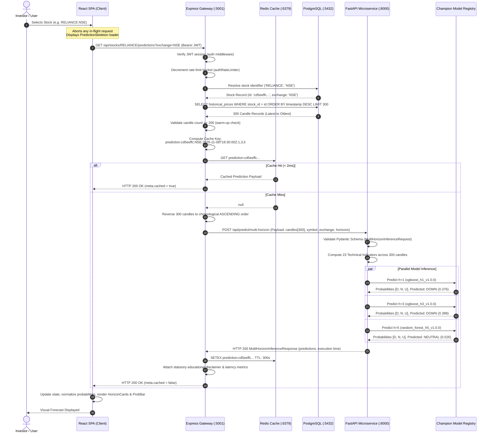
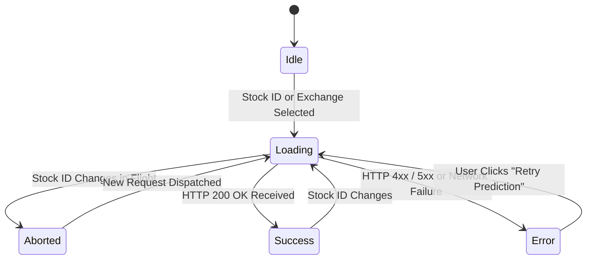

# StockSense AI — Phase 5C.6
# System Architecture & Dataflow Specification

**Project**: StockSense AI
**Component**: Quantitative Prediction Architecture
**Date**: November 18, 2026
**Auditor**: Antigravity Assistant (Google DeepMind)
**Status**: **Verified Integration Architecture**

---

## 1. System Architecture Overview

The StockSense AI quantitative prediction architecture is structured into four decoupled, resilient operational tiers:

```mermaid
flowchart TD
    subgraph Presentation Tier
        SPA["React SPA (Vite :5173)"]
        Dashboard["StockPredictionDashboard"]
        Cards["HorizonPredictionCards (h=1, 3, 5)"]
        ProbBar["ProbabilityBar (Normalized 3-Class)"]
        ManifestUI["ChampionModelManifestCard"]
        Skeleton["PredictionSkeleton (Pulse Loader)"]
    end

    subgraph API Gateway Tier
        Express["Express Backend Gateway (:5001)"]
        AuthMid["JWT Auth Guard (Bearer / Cookie)"]
        RateMid["authRateLimiter (30 req/min/user)"]
        StockRes["resolveStockIdentifier (NSE / BSE)"]
        PredCtrl["prediction.controller.js"]
        MLClient["MLServiceClient (Axios HTTP Client)"]
    end

    subgraph Data & Storage Tier
        Postgres[("PostgreSQL 16 (:5432)<br/>Table: historical_prices<br/>Index: (stock_id, timestamp DESC)")]
        RedisCache[("Redis Cache 7 (:6379)<br/>Key: prediction:{stockId}:{ex}:{ts}:{h}<br/>TTL: 300s")]
    end

    subgraph Compute & Modeling Tier
        FastAPI["FastAPI Microservice (:8000)<br/>Endpoint: POST /api/predict/multi-horizon"]
        TechFeat["TechnicalFeatureService<br/>(23 Technical Indicators)"]
        Reg["ModelRegistry (Metadata & Integrity)"]
        ModH1["Champion h1: xgboost_h1_v1.0.0"]
        ModH3["Champion h3: xgboost_h3_v1.0.0"]
        ModH5["Champion h5: random_forest_h5_v1.0.0"]
    end

    SPA --> Dashboard
    Dashboard --> Cards & ProbBar & ManifestUI & Skeleton
    Dashboard -->|GET /api/stocks/:id/predictions| Express
    Express --> AuthMid
    AuthMid --> RateMid
    RateMid --> PredCtrl
    PredCtrl --> StockRes
    StockRes --> Postgres
    PredCtrl --> RedisCache
    RedisCache -.->|Cache Hit (<2ms)| PredCtrl
    PredCtrl -->|Cache Miss| MLClient
    MLClient -->|POST /api/predict/multi-horizon| FastAPI
    FastAPI --> TechFeat
    TechFeat --> Reg
    Reg --> ModH1 & ModH3 & ModH5
    ModH1 & ModH3 & ModH5 --> FastAPI
    FastAPI --> MLClient
    MLClient --> PredCtrl
    PredCtrl -->|Cache Write (TTL 300s)| RedisCache
    PredCtrl -->|JSON Envelope + Disclaimer| Express
    Express --> Dashboard
```

### Component Boundaries & Separation of Concerns:
- **Presentation Tier (React)**: Handles interactive visualization, state management, animated probability bars, responsive layout, model inspection drawers, and request cancellation via `AbortController`.
- **API Gateway Tier (Express)**: Manages authentication, rate limiting, stock symbol resolution across exchanges, database interaction, caching orchestration, and error masking.
- **Data & Storage Tier (PostgreSQL & Redis)**: PostgreSQL acts as the authoritative system of record for historical prices and stock metadata. Redis acts as a deterministic, distributed TTL cache.
- **Compute & Modeling Tier (FastAPI)**: Stateless mathematical and machine learning compute engine that transforms raw OHLCV candles into 23 scale-invariant technical indicators and executes in-memory inference across champion estimators.

---

## 2. End-to-End Dataflow Sequence

The following sequence diagram outlines the complete lifecycle of a prediction request from the user's browser to model inference and back:



---

## 3. Candlestick Pipeline & Temporal Ordering

A critical requirement in financial machine learning is the **complete prevention of lookahead bias** and data leakage during inference.

### Step 1: Database Query in Descending Order
The backend must obtain the most recent market sessions regardless of total dataset size. The query executes:
```javascript
const candlesDesc = await prisma.historicalPrice.findMany({
  where: { stockId: stock.id, interval: '1D' },
  orderBy: { timestamp: 'desc' },
  take: 300,
});
```
- Querying in descending order guarantees that session index `0` represents the latest available market session (e.g. `2026-11-08`).

### Step 2: Algorithmic Warm-Up Threshold (Minimum 200 Candles)
Quantitative indicators require a historical lookback window for parameter stabilization:
- 200-day Simple Moving Average (SMA-200) requires exactly 200 prior periods.
- 50-day Exponential Moving Average (EMA-50) requires ~150 periods for weight convergence.
- MACD, RSI-14, Average True Range (ATR), and Bollinger Bands require sufficient preceding data to avoid edge-effect artifacts.

If fewer than 200 daily sessions exist, the gateway rejects the request with HTTP 400:
```javascript
if (candlesDesc.length < 200) {
  throw new AppError(
    `Insufficient historical daily candle data for "${stock.symbol}". At least 200 trading sessions are required for algorithmic feature warm-up (found ${candlesDesc.length}).`,
    400,
    'INSUFFICIENT_HISTORICAL_DATA'
  );
}
```

### Step 3: Reversal to Ascending Chronological Order
The ML microservice expects a time-series sequence where index `0` is the oldest session and index `N-1` is the latest session:
```javascript
const chronologicalCandles = [...candlesDesc].reverse();
```
This guarantees that feature extractors evaluate temporal trends from past to present.

---

## 4. Caching Architecture & Invalidation Strategy

The caching strategy balances sub-millisecond API responses with financial market currency.

### Cache Key Structure:
```text
prediction:{stockId}:{exchange}:{latestCandleTimestamp}:{horizons}
```
Example:
```text
prediction:cd5eeffc-e9b2-44d0-9817-1b45e8635812:NSE:2026-11-08T18:30:00.000Z:1,3,5
```

### Self-Invalidating Determinism:
1. **Timestamp Keying**: The timestamp of the most recent candle is explicitly encoded in the key. When daily EOD ingestion appends a new candle to PostgreSQL, the key immediately changes.
2. **Time-to-Live (TTL)**: A baseline TTL of **300 seconds (5 minutes)** is enforced.
3. **Fail-Open Resilience**:
   ```javascript
   let cached = null;
   try {
     cached = await cacheService.get(cacheKey);
   } catch (cacheErr) {
     logger.warn(`Redis prediction cache probe failed: ${cacheErr.message}. Falling open to live compute.`);
   }
   ```
   If Redis becomes unreachable or errors out, requests seamlessly fall through to direct ML computation without throwing errors to the client.

---

## 5. Inter-Service Communication & Fault Tolerance

Communication between the Node.js Express Gateway and the Python FastAPI Microservice is managed by `MLServiceClient` (`backend/src/services/mlClient.service.js`).

```mermaid
flowchart TD
    Req["Gateway Request"] --> MLClient["MLServiceClient"]
    MLClient --> Axios{"Axios POST /api/predict/multi-horizon<br/>Timeout: 5000ms"}

    Axios -->|Success (200)| Parse["Parse Response Schema"]
    Parse --> Success["Return MultiHorizon Predictions"]

    Axios -->|ECONNREFUSED| Err503["Catch: ECONNREFUSED<br/>Throw AppError(503, 'ML_SERVICE_UNAVAILABLE')"]
    Axios -->|ETIMEDOUT / Timeout| Err504["Catch: ETIMEDOUT<br/>Throw AppError(504, 'ML_SERVICE_TIMEOUT')"]
    Axios -->|HTTP 422 Unprocessable| Err502["Catch: Validation Error<br/>Throw AppError(502, 'UPSTREAM_PREDICTION_ERROR')"]
```

### Error Taxonomy:
- **HTTP 503 `ML_SERVICE_UNAVAILABLE`**: Raised when the Python Uvicorn process is halted, unreachable, or refused connection.
- **HTTP 504 `ML_SERVICE_TIMEOUT`**: Raised when inference compute exceeds the configured 5000ms timeout threshold.
- **HTTP 502 `UPSTREAM_PREDICTION_ERROR`**: Raised if FastAPI rejects candle features or returns unexpected error envelopes.

---

## 6. Frontend State Machine & Stale Request Cancellation

To prevent race conditions when a user navigates rapidly between different stocks, `StockPredictionDashboard.jsx` implements an active cancellation pattern using the browser's native `AbortController`:



### Stale Request Protection:
```javascript
const abortControllerRef = useRef(null);
const activeStockIdRef = useRef(stockId);

useEffect(() => {
  activeStockIdRef.current = stockId;
  if (abortControllerRef.current) {
    abortControllerRef.current.abort(); // Cancel pending network call
  }
  const controller = new AbortController();
  abortControllerRef.current = controller;

  fetchPredictions(controller.signal);

  return () => controller.abort();
}, [stockId, exchange]);
```
If an in-flight request completes after the user has navigated to another stock, `activeStockIdRef.current === stockId` checks prevent out-of-order state overwrites.

---

## 7. Closed-Market Determinism

Unlike real-time quote streaming which requires active exchange trading hours, the quantitative prediction pipeline is **closed-market deterministic**:
1. All calculations derive from finalized daily closing OHLCV candles in PostgreSQL.
2. Predictions evaluate consistently during pre-market, regular market, post-market, weekends, and exchange holidays.
3. The latest available market session is clearly communicated via the `asOfDate` field (e.g. `asOfDate: "2026-11-08"`).

---

## 8. Horizon Semantics & Label Mapping Analysis

A cross-tier audit confirms the exact semantics and label mapping across the system:

| Tier | Component | Location | Definition for $h=5$ |
| :--- | :--- | :--- | :--- |
| **ML Models** | Active Registry | `ml-service/models/registry/random_forest_h5_v1.0.0/metadata.json` | 5 discrete trading sessions (Entry: $O[t+1]$, Exit: $C[t+5]$) |
| **Backend Gateway** | Prediction Controller | `backend/src/controllers/prediction.controller.js` (line 29) | `horizonLabel`: `"5 Trading Days (1 Calendar Week)"` |
| **Frontend UI** | Horizon Card Header | `frontend/src/components/predictions/HorizonPredictionCard.jsx` (line 41) | `subtitle`: `"5 Trading Sessions"` |

The underlying computational target is strictly 5 discrete trading sessions. The backend returns an informal descriptive label with parenthetical `(1 Calendar Week)`, whereas the frontend card overrides this with `"5 Trading Sessions"` to remain precise during weeks with exchange holidays.
