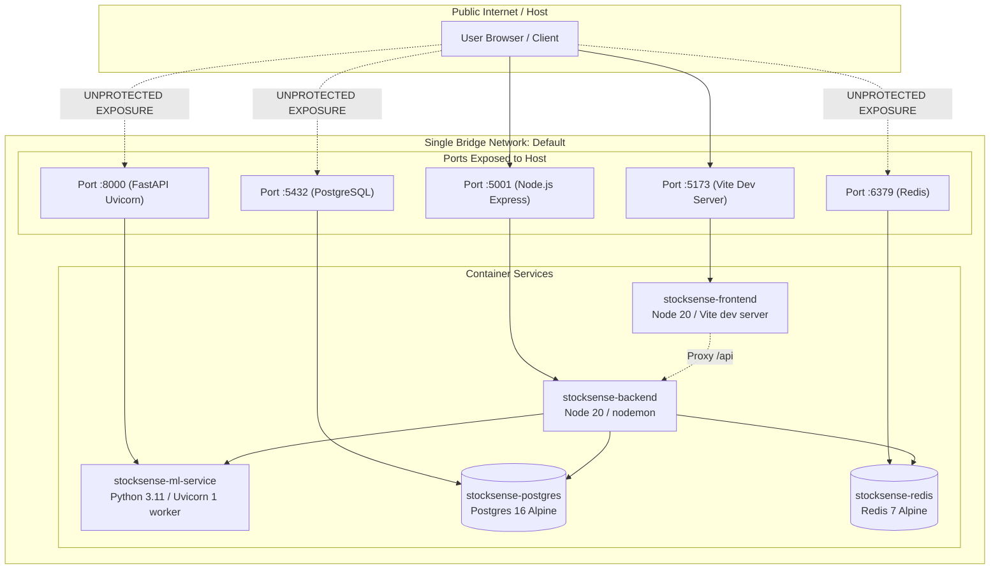
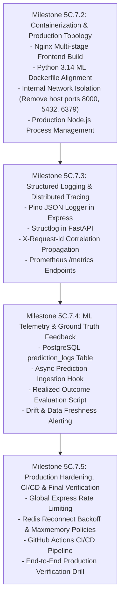

# StockSense AI — Phase 5C.7.1
# Production Readiness & Observability Architecture Audit

**Project**: StockSense AI
**Phase**: 5C.7.1 — Production Readiness & Observability Architecture Audit
**Date**: November 18, 2026
**Auditor**: Antigravity Assistant (Google DeepMind)
**Git Branch**: `feature/phase-5c-ml-training`
**Current HEAD**: `41e04ad0971f79e86b79f1b5437614870e0d8857`
**Audit Scope**: READ-ONLY Architectural, Operational, Security, Reliability, and ML Monitoring Assessment

---

## 1. Executive Summary

Phase 5C.6 successfully delivered end-to-end multi-horizon directional predictions across the application stack: React frontend, Express gateway, PostgreSQL historical store, Redis cache, and FastAPI ML inference service with three active champion models ($h=1, 3, 5$).

Before deploying this architecture to production environments, **Phase 5C.7.1** conducts an exhaustive, read-only operational audit.

### Key Audit Conclusions:
1. **Functional Completeness vs. Operational Readiness**: While functional dataflow and algorithmic inference are verified with 100% test pass rates across 154 unit, integration, and live tests, **the current infrastructure is configured for local development**.
2. **Critical Deployment Blockers**:
   - `ml-service/Dockerfile` specifies Python 3.11, whereas serialized champion model binaries enforce Python 3.14 runtime compatibility, causing an immediate fatal deserialization crash inside Docker.
   - `frontend/Dockerfile` runs the Vite development server (`npm run dev`) rather than a multi-stage production Nginx build serving optimized static assets with SPA routing.
   - The internal FastAPI ML microservice exposes port `8000` directly to the host network without authentication.
3. **Observability Void**: The platform currently lacks structured JSON logging, distributed request correlation IDs (`X-Request-Id`), Prometheus metric instrumentation, and automated ML drift monitoring.
4. **Transient Predictions**: Predictions exist only as ephemeral HTTP responses and 300-second Redis cache entries. There is no historical audit log in PostgreSQL, preventing class drift detection, confidence tracking, or realized accuracy evaluation against future market outcomes.

---

## 2. Current Architecture Topology



---

## 3. Deployment Readiness Scorecard

| Domain | Current State | Production Standard | Evaluation | Grade |
| :--- | :--- | :--- | :--- | :---: |
| **1. Frontend Containerization** | `Dockerfile` runs `npm run dev -- --host` on port 5173. Bind-mounts host source code. | Multi-stage build (`node:alpine` builder $\to$ `nginx:alpine` runtime). Pre-compressed static assets. SPA fallback rewrite (`try_files $uri /index.html`). | **FAIL** | **F** |
| **2. Backend Containerization** | `Dockerfile` runs `npm run dev` (nodemon). Runs as root user. Bind-mounts `./backend:/app`. | Multi-stage build (`npm ci --omit=dev`). Non-root user (`USER node`). Dedicated process supervision (`node src/server.js` or PM2 cluster). | **POOR** | **D** |
| **3. ML Service Containerization** | `Dockerfile` specifies `python:3.11-slim`. Single Uvicorn worker. Models require Python 3.14. | Base image aligned with model runtime (Python 3.14+). Gunicorn process manager with Uvicorn workers (`gunicorn -w 4 -k uvicorn.workers.UvicornWorker`). | **FAIL** | **F** |
| **4. Docker Compose Topology** | Single flat bridge network. All 5 container ports exposed directly to host. Bind-mounts used across all services. | Multi-tiered isolated networks (`frontend-tier`, `backend-tier`, `data-tier`). Only reverse proxy (ports 80/443) exposed to host. Zero host volume bind-mounts. | **POOR** | **D** |
| **5. Reverse Proxy & TLS** | No reverse proxy. No HTTPS termination. Direct HTTP exposure on raw container ports. | Nginx or Traefik reverse proxy terminating TLS (Let's Encrypt / custom certs), routing `/` to SPA, `/api` to Express, blocking direct public access to ML/DB/Redis. | **FAIL** | **F** |
| **6. Database Persistence & Backup** | Named volume `postgres_data` mounted to `/var/lib/postgresql/data`. No backup automation. | Automated daily/hourly WAL backups (`pg_dump` cron or WAL-G / pgBackRest) with off-site S3 storage and tested restoration drills. | **MARGINAL** | **C-** |
| **7. Redis Persistence & Limits** | `redis_data` volume mounted, but `maxmemory`, `maxmemory-policy`, and `appendonly` are unconfigured. | `maxmemory 512mb`, `maxmemory-policy allkeys-lru`, `appendonly yes`, password authentication (`requirepass`). | **POOR** | **D** |
| **8. Secrets Management** | Plaintext `.env` file on host filesystem. Strong production validation logic in `config/index.js`. | Secret injection via Docker secrets, Kubernetes secrets, or cloud key vault. Zero `.env` files on production disk. | **ACCEPTABLE** | **B** |
| **9. Database Migrations** | Prisma migrations exist, executed via development command `prisma migrate dev`. | Automated non-destructive migration execution (`prisma migrate deploy`) in container startup or CI/CD deployment pipeline. | **ACCEPTABLE** | **B-** |
| **10. CI/CD Pipeline** | Zero CI/CD workflows exist (no `.github/workflows/`, GitLab CI, or Jenkinsfile). | Automated GitHub Actions pipeline: linting, unit tests, integration tests, Docker build, vulnerability scanning, staging rollout. | **FAIL** | **F** |

---

## 4. Security Audit Findings

### 4.1 Strengths:
1. **Secret & Key Validation**: `backend/src/config/index.js` strictly rejects insecure placeholder JWT secrets, requires `JWT_SECRET` length $\ge 32$ characters, enforces 64-hex AES-256 encryption keys, and actively redacts sensitive tokens in logs.
2. **Session Security**: Authentication cookies (`stocksense_access_token`, `stocksense_refresh_token`) use `httpOnly: true`, `sameSite: 'lax'`, and automatically enable `secure: true` in production (`auth.controller.js#L29`).
3. **Double-Submit CSRF**: State-changing endpoints are protected by HMAC-signed CSRF tokens (`csrf.js`).

### 4.2 Security Vulnerabilities & Gaps:

#### Finding SEC-01: Direct Public Exposure of Internal ML Microservice (CRITICAL)
- **Component**: `docker-compose.yml` (lines 75–76)
- **Current State**: `ports: - "8000:8000"` exposes FastAPI directly to the host.
- **Risk**: The ML service has **zero authentication**. Anyone who can reach port 8000 can invoke raw model predictions, trigger indicator calculations, or query champion model metadata, bypassing Express authentication and rate limits.
- **Solution**: Remove port 8000 from `ports`. Keep it accessible only to the internal Docker network (`http://ml-service:8000`).

#### Finding SEC-02: Direct Public Exposure of PostgreSQL and Redis Ports (CRITICAL)
- **Component**: `docker-compose.yml` (lines 10–11, 24–25)
- **Current State**: Ports 5432 and 6379 are bound to all host interfaces (`0.0.0.0`).
- **Risk**: Exposes PostgreSQL and unauthenticated Redis to the public network or host-adjacent services.
- **Solution**: Remove external port mapping in production Compose, or bind exclusively to `127.0.0.1` for maintenance. Enable Redis `requirepass`.

#### Finding SEC-03: Missing Global Express Rate Limiter (HIGH)
- **Component**: `backend/src/app.js`
- **Current State**: Rate limiting is selectively applied to `/api/stocks/:id/predictions` (30 req/min) and `/api/auth/register` (5 req/15min). General routes (`/api/stocks`, `/api/market`) have no rate limiting.
- **Risk**: An attacker or misbehaved client can flood catalog routes, exhausting PostgreSQL connections and node event loops.
- **Solution**: Mount a global `express-rate-limit` middleware on `/api/` (e.g. 300 requests per 15-minute window per IP).

#### Finding SEC-04: Public Exposure of FastAPI Interactive API Documentation (MEDIUM)
- **Component**: `ml-service/app/main.py` (lines 31–36, 62)
- **Current State**: Swagger UI (`/docs`) and OpenAPI schema are enabled without environment guards.
- **Risk**: Leaks internal schemas, model parameters, and microservice route structure.
- **Solution**: Set `docs_url=None` and `redoc_url=None` when `settings.env == "production"`.

---

## 5. Observability Audit Findings

### 5.1 Structured Logging Gaps
- **Current Implementation**:
  - Express uses `morgan` writing raw formatted text strings (`:method :clean-url :status :res[content-length] - :response-time ms`) to standard out.
  - Controllers use unstructured `console.log` and `console.error`.
  - FastAPI uses Python `print()`.
- **Identified Gap**: Modern cloud log aggregators (Elasticsearch, Loki, CloudWatch, Datadog) cannot filter, index, or alert on unstructured console logs.
- **Solution**: Implement structured JSON logging (`pino` in Node.js, `structlog` in Python) outputting standardized envelopes:
  ```json
  {
    "timestamp": "2026-11-18T16:45:00.000Z",
    "level": "info",
    "service": "stocksense-backend",
    "correlation_id": "req-9b1deb4d-3b7d-4bad-9bdd-2b0d7b3dcb6d",
    "method": "GET",
    "path": "/api/stocks/RELIANCE/predictions",
    "status": 200,
    "latency_ms": 56.44,
    "user_id": "usr-8a21f",
    "cached": false
  }
  ```

### 5.2 Distributed Request Tracing (Correlation IDs) Gaps
- **Current Implementation**: Incoming HTTP requests do not receive or generate an `X-Request-Id` or `X-Correlation-Id`.
- **Identified Gap**: When an inference request fails across the boundary (`React` $\to$ `Express` $\to$ `FastAPI`), developers cannot correlate Express error logs with FastAPI compute logs.
- **Solution**: Implement correlation ID middleware in Express that generates a UUIDv4 (or accepts an existing client `X-Request-Id`), attaches it to the response header, and forwards it via `MLServiceClient` to FastAPI as `X-Correlation-Id`.

### 5.3 Metrics & Telemetry Gaps
- **Current Implementation**: Latency is tracked solely inside individual prediction responses (`totalExecutionTimeMs`). No time-series metric collection exists.
- **Identified Gap**: No visibility into:
  - Percentile API response times ($p50, p95, p99$).
  - Redis cache hit vs. miss ratios.
  - ML inference compute latency distribution.
  - Database connection pool utilization.
  - HTTP status code counters ($2xx, 4xx, 5xx$).
- **Solution**: Expose standard Prometheus `/metrics` endpoints:
  - Express: `prom-client` collecting Node runtime metrics and custom HTTP/cache counters.
  - FastAPI: `prometheus-fastapi-instrumentator` collecting Python runtime and inference latency histograms.

---

## 6. Reliability & Failure Recovery Audit

### 6.1 Database Connection Exhaustion (HIGH)
- **Current Implementation**: In `backend/src/config/prisma.js`, `new PrismaClient()` is instantiated without explicit connection pool limits.
- **Identified Gap**: Default PostgreSQL allows 100 connections. If Node processes or background jobs scale out, database connection limits will be exhausted under load, leading to `P2024: Timed out fetching a connection from the pool`.
- **Solution**: Configure explicit connection pooling parameters in `DATABASE_URL` (`?connection_limit=15&pool_timeout=10`) or deploy a dedicated PgBouncer connection pooler container.

### 6.2 Redis Reconnect Strategy Hard Cutoff (HIGH)
- **Component**: `backend/src/config/redis.js` (lines 10–13)
- **Current State**:
  ```javascript
  retryStrategy(times) {
    if (times > 3) {
      return null; // Stop retrying if Redis is not running locally
    }
    return Math.min(times * 100, 1000);
  }
  ```
- **Identified Gap**: If Redis restarts or drops for more than 3 seconds in production, `ioredis` permanently ceases reconnection attempts. The application falls back to in-memory caching and never recovers until the Node.js process is manually restarted.
- **Solution**: In production (`config.env === 'production'`), use an exponential backoff with jitter that retries indefinitely up to a 5000ms cap.

### 6.3 Single-Process Node Execution (MEDIUM)
- **Component**: `backend/src/server.js`
- **Current State**: Server runs as a single Node.js thread on port 5001.
- **Identified Gap**: Multi-core production servers underutilize available CPU resources. An uncaught exception or heavy synchronous loop blocks the entire event loop for all users.
- **Solution**: Use Node.js native `cluster` module or a container process manager (PM2 / dumb-init) to run $N$ workers matching available CPU cores.

---

## 7. Machine Learning Prediction Monitoring Audit

### 7.1 Ephemeral Predictions & Lack of Ground Truth Tracking (CRITICAL)
- **Current State**: In `backend/src/controllers/prediction.controller.js`, predictions are computed, cached in Redis for 300 seconds, and returned to the client. **No record is saved to PostgreSQL**.
- **Identified Gap**:
  1. **Zero Prediction History**: Once the 300s Redis TTL expires, the prediction record ceases to exist.
  2. **No Model Performance Tracking**: Without storing the predicted label, confidence, and timestamp, the platform cannot evaluate realized performance ($t+1, t+3, t+5$) against actual closing prices once market sessions complete.
  3. **No Drift Detection**: Impossible to detect class imbalance drift (e.g. model predicting 90% DOWN across all equities during sudden regime shifts).
- **Recommended Solution**:
  1. Create a `PredictionLog` table in PostgreSQL:
     ```prisma
     model PredictionLog {
       id             String   @id @default(uuid())
       stockId        String
       symbol         String   @db.VarChar(16)
       exchange       String   @db.VarChar(8)
       asOfDate       DateTime @db.Date
       horizonDays    Int      // 1, 3, 5
       predictedLabel String   @db.VarChar(16) // UP, DOWN, NEUTRAL
       confidence     Float
       probDown       Float
       probNeutral    Float
       probUp         Float
       modelId        String   @db.VarChar(64)
       artifactSha256 String   @db.VarChar(64)
       candlesUsed    Int
       executionMs    Float
       cached         Boolean
       actualReturn   Float?   // Populated post-session
       realizedLabel  String?  // Populated post-session
       isCorrect      Boolean? // Populated post-session
       evaluatedAt    DateTime?
       createdAt      DateTime @default(now())

       stock          Stock    @relation(fields: [stockId], references: [id], onDelete: Cascade)
       @@index([stockId, asOfDate])
       @@index([modelId, horizonDays])
       @@map("prediction_logs")
     }
     ```
  2. Implement an asynchronous, non-blocking ingestion hook in `prediction.controller.js` to log generated predictions.
  3. Implement a nightly evaluation worker (e.g. `scripts/evaluateRealizedPredictions.js`) that compares stored predictions with finalized closing prices to calculate ongoing rolling precision, recall, and macro F1 scores.

### 7.2 Data & Feature Freshness Monitoring (HIGH)
- **Current State**: The gateway validates that at least 200 candles exist, but does not alert if the latest candle (`asOfDate`) is outdated.
- **Identified Gap**: If market data ingestion halts, predictions continue running against stale candles without warning operators.
- **Solution**: Emit a Prometheus warning gauge or log alert if `now() - latestCandleTimestamp > 3 business days`.

---

## 8. Prioritized Issue & Remediation Matrix

| ID | Domain | Issue Description | Priority | Recommended Action |
| :--- | :--- | :--- | :---: | :--- |
| **DEP-01** | Deployment | `ml-service` Dockerfile specifies Python 3.11, breaking Python 3.14 model compatibility | **CRITICAL** | Update `ml-service/Dockerfile` base image to Python 3.14 (or build runtime environment matching model serialization). |
| **DEP-02** | Deployment | `frontend/Dockerfile` runs Vite dev server on port 5173 | **CRITICAL** | Implement multi-stage Docker build: build static files with Vite, serve via Nginx on port 80 with SPA rewrite. |
| **SEC-01** | Security | FastAPI port 8000 exposed directly to host without auth | **CRITICAL** | Remove port 8000 from host exposure in Compose. Restrict access to internal Docker network. |
| **ML-01** | ML Ops | Predictions are ephemeral and not persisted in database | **CRITICAL** | Create `prediction_logs` Prisma schema and asynchronous persistence pipeline. |
| **OBS-01** | Observability | Console string logging across Express and FastAPI | **HIGH** | Replace console logging with structured JSON loggers (`pino` / `structlog`). |
| **OBS-02** | Observability | No request correlation IDs between Express and FastAPI | **HIGH** | Implement `X-Request-Id` generation in Express and forward as header to FastAPI. |
| **SEC-02** | Security | Database and Redis ports exposed directly to host | **HIGH** | Remove port mappings from `docker-compose.yml` or bind exclusively to `127.0.0.1`. |
| **SEC-03** | Security | No global rate limiter on Express `/api` | **HIGH** | Add global rate limiting middleware (e.g. 300 req/15min) on all `/api` routes. |
| **REL-01** | Reliability | Redis client aborts reconnection permanently after 3 retries | **HIGH** | Update `retryStrategy` in `redis.js` to exponential backoff with jitter and no permanent cutoff in production. |
| **ML-02** | ML Ops | No automated tracking of realized model performance | **HIGH** | Implement post-session ground truth evaluation script measuring realized accuracy. |
| **OBS-03** | Observability | No Prometheus metrics instrumentation | **MEDIUM** | Add `prom-client` to Express and `prometheus-fastapi-instrumentator` to FastAPI. |
| **REL-02** | Reliability | Single-process Node.js execution without clustering | **MEDIUM** | Add Node.js clustering or container process manager (PM2). |
| **REL-03** | Reliability | Unbounded database connection pool | **MEDIUM** | Add explicit pool limits (`connection_limit=15`) in `DATABASE_URL`. |
| **DEP-03** | Deployment | Redis memory and eviction unconfigured | **MEDIUM** | Configure `maxmemory 512mb` and `maxmemory-policy allkeys-lru` in Redis container. |
| **DEP-04** | Deployment | No automated PostgreSQL backup strategy | **MEDIUM** | Add backup cron service or WAL archiving container. |
| **SEC-04** | Security | FastAPI Swagger UI (`/docs`) enabled in production | **LOW** | Disable `/docs` and `/redoc` when `ENV === 'production'`. |
| **DEP-05** | Deployment | Containers run as default `root` user | **LOW** | Add `USER node` and non-root Python users in Dockerfiles. |
| **DEP-06** | Deployment | No CI/CD workflow files | **LOW** | Create `.github/workflows/ci.yml` for automated linting, test execution, and container build checks. |

---

## 9. Recommended Implementation Sequence

To resolve these findings systematically without destabilizing verified Phase 5C.6 capabilities, the following sequential implementation is recommended:



---

## 10. Phase 5C.7 Milestone Roadmap

### Milestone 5C.7.1: Production Readiness & Observability Architecture Audit (Current)
- Comprehensive read-only audit across containerization, security, observability, reliability, and ML monitoring.
- Status: **Audit Complete**.

### Milestone 5C.7.2: Production Containerization & Network Hardening
- Multi-stage Dockerfile for React SPA with Nginx reverse proxy and SPA routing.
- Python 3.14 base image alignment for `ml-service/Dockerfile`.
- Production Docker Compose configuration with network segmentation (`public-tier`, `internal-tier`).
- Non-root user execution across all application images.

### Milestone 5C.7.3: Structured Logging, Correlation IDs & Metric Instrumentation
- Standardized structured JSON logging in Express and FastAPI.
- End-to-end `X-Request-Id` propagation across frontend, gateway, and ML microservice.
- Prometheus `/metrics` endpoints for HTTP request duration, cache hit/miss, and inference latency.

### Milestone 5C.7.4: ML Prediction Telemetry & Ground Truth Evaluation Pipeline
- Prisma schema migration for `prediction_logs`.
- Asynchronous prediction audit logging.
- Ground truth reconciliation worker computing realized accuracy, precision, and macro F1 against newly ingested daily candles.
- Prediction class balance and confidence drift monitoring.

### Milestone 5C.7.5: Reliability Resilience, CI/CD Pipeline & Final Production Verification
- Global API rate limiting and Redis exponential reconnect resilience.
- GitHub Actions CI pipeline executing automated linting, test suites, and Docker builds.
- Full end-to-end production verification drill.
