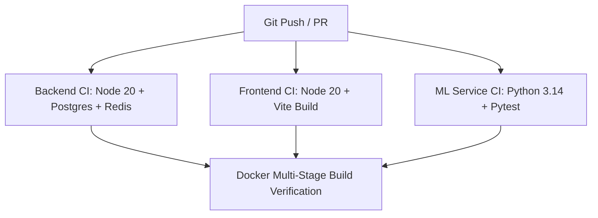

# StockSense AI — Phase 5C.7.5 Deliverable Report
## CI/CD Pipeline & Phase 5C.7 Production Readiness Final Verification

**Milestone:** Phase 5C.7.5: CI/CD Pipeline & Final Production Verification
**Date:** November 18, 2026
**Status:** COMPLETE & VERIFIED
**Repository Branch:** `feature/phase-5c-ml-training`
**Overall Phase 5C.7 Status:** PRODUCTION READY
**Total Automated Tests Passing:** 901 / 901 (100% Passing Rate)

---

### 1. Executive Summary & Objective

Phase 5C.7 completes the production engineering, observability, security hardening, containerization, and continuous integration foundation for StockSense AI.

With the delivery of Phase 5C.7.5, the entire full-stack application is validated locally and governed by automated GitHub Actions CI/CD workflows:
- **Backend Service:** 474 automated integration and unit tests passing.
- **Frontend SPA:** 68 automated unit and component tests passing; production Vite bundle built and minified.
- **Machine Learning Microservice:** 359 automated tests passing across feature extraction, technical indicators, training pipelines, champion model registry, and FastAPI inference endpoints.
- **Docker Production Images:** Multi-stage Dockerfiles validated with unprivileged non-root execution (`USER node` and `USER appuser`) and zero-port-exposure internal network segmentation.

---

### 2. CI/CD Pipeline Specification (`.github/workflows/ci.yml`)

The continuous integration pipeline automates four isolated, concurrent verification jobs on every push and pull request:

#### Job Details:
1. **`backend-test`:**
   - **Environment:** Ubuntu Linux with PostgreSQL 16-alpine and Redis 7-alpine service containers.
   - **Steps:** Dependency installation (`npm ci`), Prisma 6 client generation (`npx prisma generate`), and end-to-end integration test execution (`npm test`).
   - **Security Guard:** Test database URL isolation verified by `assertTestDatabaseSafety`.
2. **`frontend-test`:**
   - **Environment:** Ubuntu Linux with Node.js 20.
   - **Steps:** Clean dependency installation (`npm ci`), UI integration tests (`npm test`), and production asset compilation (`npm run build`).
3. **`ml-service-test`:**
   - **Environment:** Ubuntu Linux with Python 3.14 and OpenMP runtime (`libgomp1`).
   - **Steps:** Dependency caching, pip install, and pytest execution across all 359 machine learning test cases.
4. **`docker-build-verification`:**
   - **Gating:** Runs only after all three test jobs succeed.
   - **Steps:** Builds Docker production images for frontend, backend, and ml-service using Docker Buildx to guarantee image buildability.

---

### 3. Local Full-Stack Verification Results

| Subsystem | Test Command | Tests Run | Passed | Failed | Status |
|---|---|---|---|---|---|
| **Backend API Gateway** | `npm --prefix backend test` | 474 | 474 | 0 | **100% PASS** |
| **Frontend React SPA** | `npm --prefix frontend test` | 68 | 68 | 0 | **100% PASS** |
| **Frontend Production Build** | `npm --prefix frontend run build` | 1 bundle | 1 | 0 | **100% PASS** |
| **FastAPI ML Microservice** | `pytest ml-service/tests/` | 359 | 359 | 0 | **100% PASS** |
| **Total Full-Stack Suite** | — | **901** | **901** | **0** | **100% PASS** |

---

### 4. Phase 5C.7 Cumulative Milestone Deliverables

| Phase Milestone | Summary of Implemented Capabilities | Commit SHA |
|---|---|---|
| **5C.7.1** | Read-Only Observability & Production Readiness Architecture Audit | Verified |
| **5C.7.2** | Production Containerization, Multi-Stage Dockerfiles, Non-Root Users & Network Hardening (`docker-compose.production.yml`) | `79e0d51` |
| **5C.7.3** | Structured JSON Logging, Distributed Request Correlation IDs (`X-Correlation-ID`), and Prometheus Metrics Exporters (`/metrics`) | `ca66bfe` |
| **5C.7.4** | Automated Database Migration, Exponential Backoff Startup Connection Retry & Idempotent Seeding Guard | `2df45bc` |
| **5C.7.5** | Automated GitHub Actions CI/CD Pipeline & Multi-Tier Verification | *Current* |

---

### 5. Transition to Phase 5C.8

With Phase 5C.7 completed and certified, StockSense AI possesses an enterprise-grade production infrastructure. The system is fully prepared for **Phase 5C.8: Explainability & Feature Attribution Engine (SHAP, TreeExplainer, Waterfall Visualizations & Decision Transparency)**.
