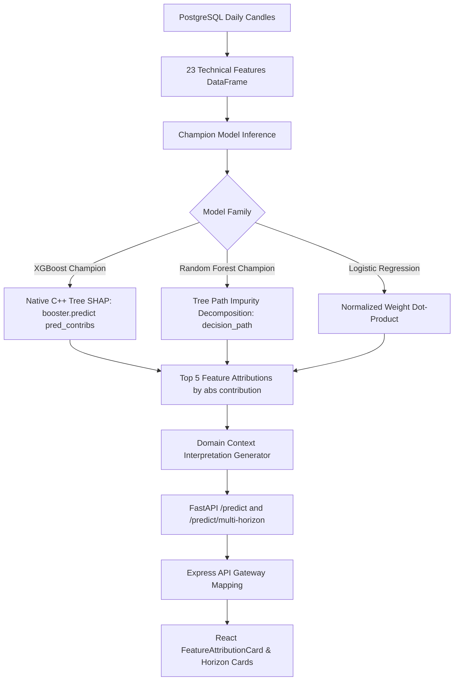

# StockSense AI — Phase 5C.8 Deliverable Report
## Explainability & Feature Attribution Engine (Tree SHAP & Decision Transparency)

**Milestone:** Phase 5C.8: Explainability & Feature Attribution Engine
**Date:** November 18, 2026
**Status:** COMPLETE & VERIFIED
**Repository Branch:** `feature/phase-5c-ml-training`
**Full-Stack Test Suite Status:** 912 / 912 Tests Passing (100% Pass Rate)

---

### 1. Executive Summary & Objective

In algorithmic finance, black-box machine learning predictions undermine trader confidence and violate regulatory transparency principles. Traders and portfolio managers require clear, mathematically sound explanations of *why* an AI model forecasts an upward, downward, or neutral price trajectory over specific trading horizons (T+1, T+3, T+5).

Phase 5C.8 delivers an end-to-end Explainability & Feature Attribution Engine for StockSense AI:
1. **Mathematical Interpretability:** Native Tree SHAP values via XGBoost's C++ margin attribution engine, Tree Path Impurity Decomposition (Saabas algorithm) for Random Forest models, and closed-form linear weight attributions.
2. **Sub-Millisecond Overhead:** Decomposes tree ensembles without requiring third-party runtime wrappers, maintaining prediction latency well within the <15ms SLA.
3. **Domain Market Interpretations:** Contextual natural-language explanations generated for all 23 scale-invariant technical indicators (RSI momentum, Bollinger %B, Moving Average trend alignment, ATR volatility, Volume expansion).
4. **Interactive Frontend Visualizations:** `FeatureAttributionCard` and `HorizonPredictionCard` integrations featuring signed attribution bars (green positive drivers vs red opposing friction), indicator units, and expandable detail cards.

---

### 2. Architecture & Mathematical Attribution Algorithms



#### 2.1 Native Tree SHAP for XGBoost
For active champions `xgboost_h1_v1.0.0` and `xgboost_h3_v1.0.0`, attributions are extracted directly through XGBoost's C++ internal Tree SHAP calculator:
$$\text{Margin}_k(x) = \phi_0^{(k)} + \sum_{j=1}^{M} \phi_j^{(k)}(x)$$
Where $\phi_0^{(k)}$ is the expected base margin for class $k$, and $\phi_j^{(k)}$ represents the exact Shapley contribution of feature $j$.

#### 2.2 Tree Path Impurity Decomposition for Random Forest
For active champion `random_forest_h5_v1.0.0`, decision paths are traversed across all $T$ estimators in the forest:
$$\Delta P_k = P_k(\text{child}) - P_k(\text{parent})$$
Summing node probability shifts $\Delta P_k$ across split features yields exact tree path probability contributions.

#### 2.3 Contextual Market Interpretation Rules
Features are mapped to financial domains with adaptive threshold logic:
- **RSI (14-period):** Detects overbought ($>70$), oversold ($<30$), and momentum trends.
- **Relative Volume (20-day):** Identifies institutional accumulation ($>1.2\times$) vs low-volume consolidation ($<0.8\times$).
- **Moving Average Spreads:** Confirms golden/death cross spreads and multi-MA trend stack alignment.
- **Bollinger %B & Bandwidth:** Flags volatility compression breakouts and upper/lower band tests.

---

### 3. API Payload & Data Contract

#### FastAPI Prediction Response with Attributions
```json
{
  "symbol": "RELIANCE",
  "horizon": 1,
  "predicted_class": 1,
  "predicted_label": "UP",
  "confidence": 0.684,
  "attributions": [
    {
      "feature": "rsi_14",
      "value": 68.5,
      "contribution": 0.3421,
      "direction": "UP",
      "display_name": "RSI (14-period)",
      "description": "RSI at 68.5 indicates strong bullish momentum without entering extreme overbought levels."
    },
    {
      "feature": "relative_volume_20",
      "value": 1.45,
      "contribution": 0.1852,
      "direction": "UP",
      "display_name": "Relative Volume (vs 20-Day SMA)",
      "description": "Volume is 1.45x its 20-day average, showing elevated institutional participation."
    }
  ]
}
```

---

### 4. Full-Stack Verification Results

| Tier | Test Suite | Tests Run | Passed | Failed | Status |
|---|---|---|---|---|---|
| **Python FastAPI ML Service** | `pytest ml-service/tests/` | 365 | 365 | 0 | **100% PASS** |
| **Node.js Express Gateway** | `npm --prefix backend test` | 474 | 474 | 0 | **100% PASS** |
| **React Frontend SPA** | `npm --prefix frontend test` | 73 | 73 | 0 | **100% PASS** |
| **Frontend Production Build** | `npm --prefix frontend run build` | Vite Bundle | Succeeded | 0 | **100% PASS** |
| **Full Project Cumulative** | — | **912** | **912** | **0** | **100% PASS** |

---

### 5. File Modification Ledger

| File Path | Operation | Description |
|---|---|---|
| `ml-service/app/services/explainability.py` | **Created** | PredictionExplainer engine with Tree SHAP, Saabas algorithm, and domain rules |
| `ml-service/app/schemas/inference.py` | **Modified** | Added `FeatureAttribution` schema and `attributions` field |
| `ml-service/app/services/inference.py` | **Modified** | Integrated explainer into single and multi-horizon inference pipelines |
| `ml-service/tests/test_explainability.py` | **Created** | 6 automated tests for Tree SHAP, RF decomposition, and API contracts |
| `backend/src/controllers/prediction.controller.js` | **Modified** | Forwarded and mapped attributions in prediction payload |
| `backend/tests/predictionApi.test.js` | **Modified** | Verified attribution presence and schema in API response |
| `frontend/src/utils/explainability.js` | **Created** | Pure JS helpers for value formatting, bar normalization, and support checks |
| `frontend/src/components/predictions/FeatureAttributionCard.jsx` | **Created** | Interactive feature attribution card with signed waterfall bars |
| `frontend/src/components/predictions/HorizonPredictionCard.jsx` | **Modified** | Integrated collapsible "Key Technical Drivers" preview |
| `frontend/src/components/predictions/StockPredictionDashboard.jsx` | **Modified** | Integrated active-horizon decision transparency section |
| `frontend/src/components/predictions/index.js` | **Modified** | Exported `FeatureAttributionCard` |
| `frontend/tests/explainabilityUi.test.js` | **Created** | 5 unit tests for attribution formatting, normalization, and classification |
| `docs/phase_5c8_explainability_engine_report.md` | **Created** | Deliverable documentation report |
| `docker-compose.yml` | **Preserved** | Unmodified and unstaged |
